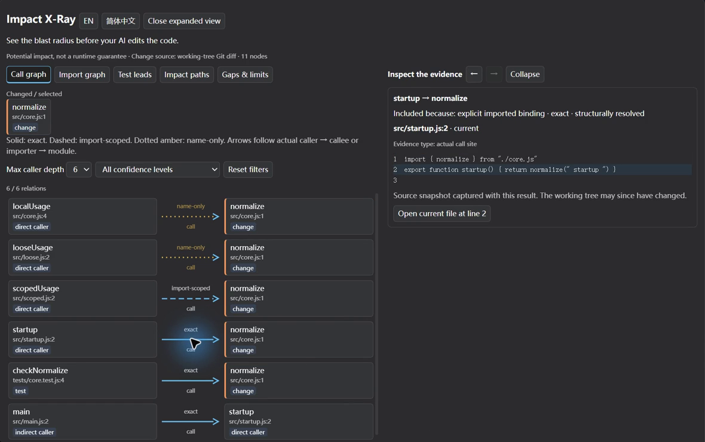
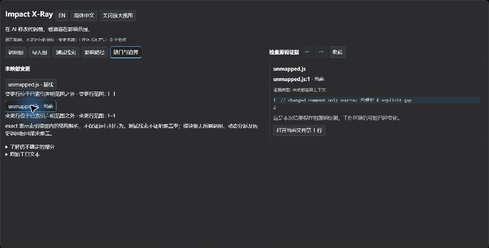

# Impact X-Ray — MVP review

2026-10-21 · `feat/v0.11-impact-xray` · PoC `01f70bf` · published v0.10.2 baseline `ba24d2a`.

**结论：实现和本轮 MVP 验证完成，提交 MVP REVIEW；未宣告 RC READY。** 当前版本为 `0.11.0-dev.0`。仅准备开发分支与 Draft PR，等待用户审查后再决定最终 RC 关卡。没有 npm 发布、tag、Release、main 合并或宿主/第三方修改。

## 功能和操作

**See the blast radius before your AI edits the code.**

本次沿用 [PoC 已验证的宿主链路](IMPACT_XRAY_POC.md)：已有 `code_change_context` 分析 → 有界展示 DTO → `output.presentationMeta` → 持久化 `block.meta` → 原生 keyed tool slot。没有新增分析引擎或服务。

```json
{"repoRoot":"D:/absolute/path/to/repo","outputFormat":"xray"}
```

在真实 Desktop 中展开工具回合和卡片，点击“放大查看”。左侧选择调用图、导入图、测试线索、影响路径或缺口；右侧直接检查源码证据。点击节点查看声明/模块上下文，点击箭头查看实际调用/导入行；通过历史按钮返回上一选择。当前文件可打开原生预览，base 快照保留其 Git ref，不提供当前文件入口。界面跟随宿主语言，并可切换 English / 简体中文。

| 要求 | 最终行为 |
| --- | --- |
| 真实修改中心 | 复用 Git / supplied diff 的真实声明映射；显式 files/symbols 标为选择，不宣称已修改。支持现有 SymbolInfo 的函数、类等声明及模块端点。 |
| 影响关系 | 只投影分析返回的 hop；每条实际关系独立一行，保留 caller → callee 方向，避免交叉线误指其他节点。间接路径保留整条路径最弱的 provenance。 |
| 导入和测试 | 用已有 importDetails 定位导入语句，画 importer → module；测试候选有真实上下文和原因，不补造函数调用边。 |
| 来源语义 | `exact` 实线、`import-scoped` 虚线、`name-only` 黄色点线。结构解析不等于运行时必然影响；同文件名称回退也不提升为 exact。 |
| 证据和缺口 | 文件/行号、side/ref、原始来源和纳入原因；未映射 current/base 行范围、缺失/过期源码、证据预算和分析/展示裁剪分别提示。 |
| 规模和导航 | 初始 6 条、每次 +6、本地收起；深度/来源筛选、路径聚焦、32 项选择历史。放大视图使用原生 HTML dialog，Escape 可退出。 |
| 兼容原工具 | 省略 outputFormat / 指定 text 仍返回原有 canonical 字符串；`code_context` pack 与现有关系解析、索引、语言支持保持不变。 |



**30 秒真实演示：**[GIF](assets/impact-xray-mvp.gif) · [MP4](assets/impact-xray-mvp.mp4) · [复现及剪辑来源](assets/impact-xray-mvp-demo.md)。[英文 README](README.md#impact-x-ray)、[中文 README](README.zh.md#impact-x-ray) 和[双语功能说明](assets/impact-xray-v011-announcement.md) 已更新。

## 验证门槛和证据

最小可观察结果：真实 diff 产生修改中心；点击实际关系后源码逐行匹配；测试/导入/间接路径可追溯；零节点、非法路径、裁剪和缺失证据均明确降级；重启可回放。以此验证本插件，不扩展到宿主或其他插件诊断。

| 验证 | 结果与方法 |
| --- | --- |
| Node 22.23.3 | **253 / 253** 全量测试，typecheck、服务端/客户端构建通过 |
| Node 24.19.0 | **253 / 253** 全量测试，typecheck、服务端/客户端构建通过；两版 runtime 产物哈希一致 |
| Packed 安装矩阵 | 同一最终 tgz：Node 22 / 24 × dsh-tools 0.2.0-rc.2 / 0.2.1-rc.2，**4 / 4** 通过；实际 Cordis ToolRuntime dispatch/render/meta、多语言、默认文本和 X-Ray 证据检查 |
| 真实 Desktop 0.2.1-rc.2 | 3 个 completed 回合、5 次实际工具调用；不是 CLI 输出或模拟卡片替代 UI |
| 源码审计 | **82 个源码窗口**匹配真实仓库文件或对应 Git base；1 个 source-budget 明确缺口；调用边与独立重建的既有分析 hop 对照 |
| 图交互 | 节点/三档调用关系、导入关系、测试文件、两步路径、路径聚焦、选择返回、EN/中文、深度和来源筛选、无匹配状态、6 → 12 → 6 展开/收起、原始文本披露均实测 |
| 空结果与错误路径 | 干净 Git 仓库 0 节点/边；`../outside.js` 被拒绝，卡片显示原始错误文本。保留工具原有字符串错误行为，不改变 isError 约定。 |
| 大结果及不可信文本 | 80 个显式导入调用者加 1 个长文件调用者，最终 32 节点/29 边；HTML/script 字符串按源码文字显示，窗口标题未被注入改变；超长源码显示 source-budget，不生成替代代码 |
| 未映射和 base | 真实 comment-only Git 修改产生 base/current 各 1–1 行；首次点击当前侧即显示真实注释源码。删除 base、过期索引、4,000 项选择、非法/旧 metadata、递归/循环关系另有程序测试。 |
| 原生文件预览 | 打开正确测试文件；中文/空格文件名、含 `&` 的仓库路径正确；无需手动滚动，原生预览中请求的第 **142** 行可见。未声称编辑器 caret 定位。 |
| 重启回放 | 新 metadata 与修复后的零节点结果实机回放正常；旧 PoC v1 metadata 仍通过校验/回归，PoC 阶段已实机回放。 |
| 环境保持 | 原包/PoC 备份保留；profile package.json、cordis.yml、cordis.patch.yml、pnpm-lock.yaml 哈希不变；HANDOFF_PROMPT.md 哈希不变且未提交 |

可追溯材料：[验证摘要与哈希](assets/impact-xray-mvp-validation.json)、[实际工具结果/源码核对](assets/impact-xray-mvp-evidence.json)、[实机截图来源](assets/impact-xray-mvp-ui-evidence.json)、[性能原始观测](assets/impact-xray-mvp-performance.json)、[媒体来源与哈希](assets/impact-xray-mvp-media.json)。完整本地日志和原始录屏保留于忽略目录 `.dsh-code-index/impact-xray-mvp/`；公开素材已裁去其他窗口和侧栏。

实机发现并修复了“没有 mapped node 时，第一次选择 unmapped 行跳过证据”的游标缺陷。新增测试直接运行卡片事件和状态转移；旧逻辑失败、修复后通过，并再次经过真实 Desktop 首次选择验证。该测试不是 DOM/布局测试，布局验收依据实机。自动化未能识别系统录屏选区层，由用户启动选区录制；后续点击、停止和媒体处理由工具完成。



加载/无效 metadata/宿主文件打开失败有明确状态和文本回退。加载画面的短暂出现及宿主拒绝文件打开未另作录像验收；不把代码分支或测试断言冒称为手动观察。没有宿主/第三方 blocker，无需隔离或修改其他插件。

## 宿主兼容边界

peerDependencies 保持 `@deepseek-ai/dsh-tools: 0.2.0-rc.2 || 0.2.1-rc.2`，没有放宽版本范围。只使用已存在的 keyed slot、`block.meta`、`openFile(path, {line})` 和 locale store；放大/选择通过 React 和浏览器 DOM 实现。

- **0.2.1-rc.2：**实际安装包、真实 Desktop 操作、原生预览、重启回放及四组矩阵中的新 API 组。
- **0.2.0-rc.2：**真实官方包 ToolRuntime 安装 smoke，以及官方 client bundle 的 slot/props/locale 源码核对。旧/新 tool UI 分别保留同一 `tool.call.toolview` keyed 入口，owner 都含 toolName、call、openFile；`block.meta` 可读取。旧版多出的 hookContext 不被本插件依赖。
- **回退策略：**X-Ray 为可选输出；metadata 缺失或不合法时显示原始工具文本；客户端 slot 不可用时宿主 generic 工具行仍取得同一已渲染文本。两个 API 组均验证了默认文本与 X-Ray 的模型文本一致（未触发 X-Ray 文本预算时）。

**本轮没有重新运行旧版 Desktop 可执行文件的完整 UI。** API/源码核对不是旧二进制 UI 实测；该项保留为正式 RC 前的兼容风险。新版本的完整 Desktop 验证不应被外推为任意 Host 或浏览器支持。官方 bundle SHA256：旧 `f4f80608932832049d93037273921e2209c022deade4145efa27328311a6779b`；新 `c37c08369505ce10d0e16282f0dce817db62664aac68ffbed8eba172da629c9e`。PoC 的 [实际 asar 审计](assets/impact-xray-poc-host-api.json) 另行保留。

## 性能和资源边界

新增投影硬上限：32 节点、48 边、12 路径、导入/测试各 8 条、未映射项 8 条（每项 16 范围），单段源码 900 字符、metadata 96,000 UTF-8 bytes。最多先收录 12 个变更声明，调用关系最多使用 24 个符号节点/32 边，给模块端点留出预算。超预算先移除源码并说明缺口，仍超限则返回明确降级。可选 X-Ray 文本另限 24,000 JS 字符；默认文本不加此限制。

实测环境：Windows x64、Node 24.19.0、Ryzen 9 7940HX，约 15.2 GiB 物理内存。脚本 `scripts/impact-xray-benchmark.mjs` 为每个规模启用独立进程，生成真实 TS 文件，显式选择 core.ts；每组 1 次冷索引、3 次 warm 分析/投影。**这是合成文件选择实验，不是生产 Git 大仓库或渲染器 benchmark。**

| 文件 / 符号 | v0.10.2 冷索引 ms | MVP 冷索引 ms | MVP warm 投影 ms（3 次范围） | MVP metadata bytes | baseline / MVP 峰值 RSS MiB |
| --- | ---: | ---: | ---: | ---: | ---: |
| 6 / 11 | 198.55 | 176.99 | 4.64–8.54 | 15,627 | 514 / 885 |
| 100 / 199 | 1,880.01 | 1,926.47 | 17.07–18.88 | 29,696 | 1,293 / 1,292 |
| 600 / 1,199 | 11,738.00 | 12,648.83 | 16.42–21.79 | 30,078 | 1,293 / 1,293 |

100/600 文件结果均发生裁剪，最终 32 节点/30 边。真实六文件 Desktop Demo metadata 为 10,554 bytes；边界夹具为 27,153 bytes。新增图依赖为零。没有测量渲染 FPS 或单卡片 heap，也没有速度、准确率或 Token 节省宣传。

既有冷索引/WASM parser 的大内存峰值在基线也存在，小样本峰值有明显差异。展示上限只约束投影、metadata 和 DOM；**底层索引/引用图仍先构建，不能保证大仓库分析的固定 CPU/内存上限。** 这些观测不构成性能改善结论。

## 与 v0.10.2 的交付对比

| 项目 | v0.10.2 | 本分支 |
| --- | ---: | ---: |
| npm 压缩包 bytes | 415,815 | 456,831 |
| 解包 bytes | 3,150,476 | 3,294,192 |
| 包文件数 | 19 | 23 |
| client.js bytes | 17,328 | 58,814 |
| index.js bytes | 175,233 | 184,901 |
| runtime dependencies | 5 | 5（完全相同） |
| devDependencies / peers / engines / lockfile / grammar | 基线 | 未改变 |

压缩包增加 **41,016 bytes / 9.86%**。增加内容主要是投影/双语 UI、源码证据展示、测试/demo/处理脚本；没有引入图形框架。源码和模型输出关系精度保持原有边界，`code_context` pack 没有更换算法或契约。

最终 tgz SHA256：`6706e11417057d3c97e3cf14b814de739d2de9aa4450617eb3316b2bbac6575f`。此包仅用于本地安装验证，不是 npm 已发布版本。README 媒体保存在 Git 仓库，不增加 npm 包素材体积。

## 剩余限制和后续建议

1. 这是一份请求时的有界快照；展开不向后端追加查询。需要更多结果时缩小变更选择或重新请求现有分析参数。结果缺失不证明没有影响。
2. 源码窗口围绕声明或调用/导入位置，不是完整补丁或完整函数；大型声明中的远处修改仍需原生预览。工作区可在请求后改变，mtime 检查不等于内容哈希证明。
3. 代表 caller/path 去重和已有裁剪继续存在；模块级无所属调用、动态分派、遮蔽、重导出、删除后的完整历史调用图及部分语言语义不保证覆盖。未扩展 ArkTS 深层语义。
4. name-only 保留候选语义；测试路径/名称/导入线索不证明测试覆盖或必然失败。图不按排版补边。
5. 正式 RC 前优先补旧 Desktop 可执行文件 UI 复测、更多生产仓库样本和渲染资源测量。若需要真正后端渐进展开，应单独设计请求/快照一致性，不扩展成通用图数据库或 IDE。

达到本轮 **MVP REVIEW** 后停止；下一步是用户审查 Draft PR，而不是自动转 Ready、合并或发布。

## English review summary

Impact X-Ray is a bounded, bilingual Desktop presentation of existing `code_change_context` analysis. It preserves actual call/import endpoints, original provenance and weakest-path confidence, and exposes source, unmapped ranges, clipping and uncertainty. Default text and Context Packs remain compatible. A native expanded view makes the graph and source evidence readable together.

Node 22 and 24 each passed 253 tests, type checking and matching builds. The final archive passed all four Node/DSH-tools installation combinations. Actual Desktop 0.2.1-rc.2 exercised selection, paths, imports, tests, filters, expansion, native line preview, error/empty/large/source-gap states and replay; 82 persisted source windows matched real repository or baseline contents. The 30-second recording is genuine Desktop footage replaying a real result. The user started system recording; graph actions and stopping used Computer Use.

No dependencies or peer ranges changed. The archive is 456,831 bytes, up 9.86% from v0.10.2. Cold parser/index memory remains substantial; UI bounds are not whole-analysis resource guarantees. Old 0.2.0-rc.2 API/runtime compatibility was checked, but its full Desktop binary UI was not rerun here. **MVP REVIEW, not RC READY**; no publication, tag, Release, main merge or Host modification occurred.
