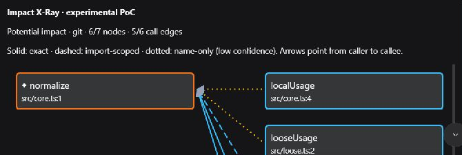
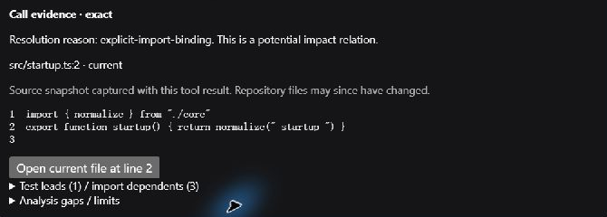
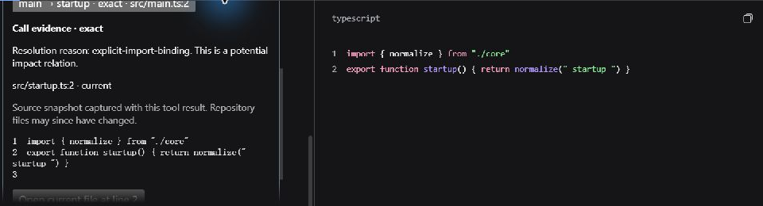
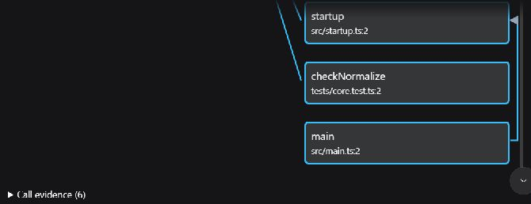

# Impact X-Ray — architecture audit and PoC

2026-10-20 · `feat/v0.11-impact-xray` · baseline `origin/main` **ba24d2a** (v0.10.2).

**结论：核心链路可行，首轮 PoC 通过；尚未进入完整 MVP，也未达到 RC READY。**

实际 DSH Desktop **0.2.1-rc.2** 已验证：工具结果 → 影响图 → 节点选择 → 真实源码证据；同时验证了展开、调用关系选择、原生文件预览和重启后的结果回放。无需新服务、Host 修改或新增图形依赖。当前包版本仍为 0.10.2，仅用于本分支实验安装，不是已发布的 v0.11。

## 最小通过条件与方法

本轮只要求一个真实 Git 改动能产生带来源的图，点击后显示匹配仓库行的源码。使用一个六文件 Git 仓库，核心函数 `normalize` 从 `trim()` 改为 `trim().toUpperCase()`。一个真实 Desktop GLM-5.3-Flash 回合产生 **1 次工具调用、1 次成功结果、completed**；没有用模拟卡片或 CLI 截图替代 Desktop。

证据：[运行与源码审计](assets/impact-xray-poc-evidence.json) · [实际宿主 API 文件哈希](assets/impact-xray-poc-host-api.json)。截图均由真实窗口截图作矩形裁切，没有生成界面、叠字或重输源码；原图 SHA256、裁切区域和时间顺序限制记录在证据中。它们不是连续视频。







## 架构审计

| 现有能力 | 已核实的数据 / 接口 | 精度与取舍 |
| --- | --- | --- |
| `code_change_context` | `ChangeContextResult`：`changed`、`unmapped`、`directCallers`、`impact`、`paths`、`importDependents`、`tests`、`warnings`、分项 `truncated` | 直接复用，不新建分析引擎。Git / inline diff / 文件 / 符号选择均已存在；显式文件或符号选择不能当成已发生的 Git 修改。 |
| 修改点 | `ChangedSymbol.symbol`、`change`、`side`、`focusLine`；未映射范围和原因 | diff hunk 与声明范围相交是结构证据。删除使用 base 内容；没有重建完整历史调用图。 |
| 调用关系 | `ImpactHop.fromId/toId`、`callSite.file/line`、`resolution`、`reason` | 图只使用实际 hop，不按列表邻接生成边。caller / impact 行会去重和选择代表路径，不能声称枚举了全部调用位置。 |
| 关系精度 | `refgraph.ts` 的 AST 所属关系、显式导入绑定、namespace、已解析导入模块、名称回退 | `exact` 是索引模型内的结构解析，不是运行时必然影响。`import-scoped` 是范围证据；`name-only` 是候选。连同同文件的 `local-unique` 都可能保留 `name-only`，UI 不提升标签。 |
| 间接路径 | 既有反向调用遍历与 shortest paths；路径置信度取较弱一档 | 每条显示边保留自己的原始标签；“边 exact”不意味着整条路径 exact。完整 MVP 还需明确显示累计路径置信度。 |
| 导入与测试 | `ImportDependent` 有文件和 specifier；`AffectedTest` 有文件、reason、distance、resolution | 不是逐条函数调用证据。PoC 单列显示，不画成函数调用边；没有凭空给测试补造连接。导入语句定位可在后续用现有 `importDetails` 完成。 |
| `code_context` | 已有 Context Pack 的符号、原因、当前/base 源码、关系来源与字符预算 | 是已有能力；本次未修改其 API、选择逻辑或重新宣传为新增源码引擎。 |
| 源码读取 | 复用 `sourceReader`：真实路径限定仓库、已索引文件、mtime 检查、读前后 stat、1 MB 文件上限；base 使用 Git ref | 源码只在请求时读取，不进索引缓存。PoC 使用带行号的小窗口；缺失/过期/超预算显示缺口，不生成源码。mtime 检查不等于内容哈希证明。 |
| Desktop 客户端 | 实际 asar 的 `tool.call.toolview` keyed slot 提供 `toolName`、`block`、`openFile`；React 工厂已存在 | `presentResult()` 不是 Web/Desktop 卡片传输通道。持久化 `output.presentationMeta` → `block.meta` 已由真实回合和重启回放验证。 |
| 原生文件入口 | 实际宿主已有 `openFile(path, { line })` | 点击后打开了正确的 `startup.ts` 原生预览，请求的第 2 行可见；三行小文件不足以独立证明长文件滚动或编辑器光标精确定位。base 快照不提供“打开当前文件”按钮。 |

主要实现位置：[数据投影](src/impact-xray.ts)、[客户端](src/client/impact-xray.tsx)、[工具接入](src/tools.ts)、[测试](tests/impact-xray.spec.ts)。

## 技术方案与 PoC 范围

`code_change_context` 增加可选 `outputFormat: "xray"`，返回 `{ text, xray }`；省略该参数或指定 `text` 时仍返回原有 canonical 字符串。原生/model 内容继续是文本，图和源码快照通过工具私有 metadata 持久化。客户端只在合法 metadata 存在时启用 PoC 卡片，其余调用保留原卡片。

使用 React state、SVG 和 HTML 按钮。选中节点显示符号、路径、行号、入选原因；选中关系显示实际调用位置、来源和源码。实线 / 虚线 / 黄色点线分别对应 `exact` / `import-scoped` / `name-only`。关系列表也提供可操作的按钮。

PoC 限制为 **20 节点、32 条边、每段源码至多 900 字符、metadata 至多 64,000 UTF-8 bytes**；初始显示 6 节点，每次展开 6 个。测试与导入线索各至多 8 条。源码使用完整行窗口，超预算时不截断伪装成完整代码。超大 metadata 返回明确的省略说明；xray 模式的文本另限 24,000 JS 字符，不能把 metadata 上限理解为整个工具结果的字节上限。默认旧文本不增加此限制。

实机发现并修复了一个可误导读者的布局：同列 `main → startup` 的线会穿过中间测试卡片。最终客户端将其绕到卡片外侧，保留原始端点；实际回放已复核：



这是**有界结果内的本地展开**，并非每次点击重新查询后端的渐进分析。界面显示的是请求时的源码快照，并明确说明仓库可能随后变化。

## 验证结果

| 验证 | 结果 / 方法 |
| --- | --- |
| Node 22.23.3 | 246/246 测试、类型检查、服务端与客户端构建通过 |
| Node 24.19.0 | 246/246 测试、类型检查、服务端与客户端构建通过 |
| 最终构建 | Node 22/24 客户端产物 SHA256 一致；最终走线改动另经实际 Desktop 回放检查 |
| 原有行为 | 原有 242 项测试保留；原生 ToolRuntime 检查默认字符串与 xray 渲染文本一致；未修改 `code_context`、解析器、关系精度或依赖版本 |
| 新增 4 项 PoC 测试 | 真实 diff、三档来源、仅复用 hop、源码逐行匹配、原生 ToolRuntime metadata、空结果、过期源码、4,000 项选择的展示上限、非法 metadata、Windows / 中文 / 特殊路径及路径穿越拒绝 |
| 打包与安装 | 本地 `npm pack --ignore-scripts` 冻结包，20 个 Desktop 安装文件逐一匹配；Node 22/24 的已安装包经过实际 `dsh-tools@0.2.1-rc.2` Cordis ToolRuntime dispatch/render/meta smoke |
| 真实 Desktop | 7 节点、6 条真实调用边（3 exact、1 import-scoped、2 name-only）、1 条测试线索、3 条导入依赖；节点、关系、展开、原生预览和重启回放可操作 |
| 源码审计 | 持久化结果中 7 个节点和 6 条边的 **13 个源码窗口**逐一匹配真实 fixture 文件；每条边也与独立重建的既有分析 hop 对照 |
| 环境边界 | profile 的 `package.json`、`cordis.yml`、`cordis.patch.yml`、`pnpm-lock.yaml` 哈希不变；没有宿主/第三方 blocker，无需隔离或修改其他插件 |

开发检查最初被沙箱的依赖访问和 Vitest 临时缓存 rename 权限阻止；正常权限运行后通过，未因此修改插件或宿主。一次 Node 24 复测仅在测试清理发生 Windows `EBUSY`，新增夹具清理的有限重试后 246/246 通过。自动权限审批的一次超时经一次重试完成。

本轮不是两个 RC 组的完整重新安装发布门禁。旧 RC `0.2.0-rc.2` 通过现有开发依赖测试；新 RC `0.2.1-rc.2` 额外经过实际安装包和 Desktop。正式 RC 阶段仍需执行任务书的完整矩阵。

## 性能与已知限制

实际小仓库的 metadata 为 **5,818 bytes**。证据保存了单次工具时间和两次 warm smoke 时间，仅用于记录；样本太小且运行环境不同，不作速度、准确率或 Token 节省宣传。

展示上限只约束新增投影和 DOM；底层 `buildChangeContext` 仍先构建现有参考图，不能据此声称整个大仓库分析具有固定 CPU/内存上限。现有分析深度 1–6（默认 3）和行数裁剪保留不变。

模块级无所属函数的调用不进入当前 change-context caller 行；代表路径去重、删除后的历史关系、动态调用、参数遮蔽、重导出及部分语言语义均有覆盖边界。未映射变更在 PoC 只显示文件、side、reason；完整 MVP 需呈现具体范围，并区分分析端裁剪与显示端裁剪。

两列 PoC 布局对自调用和多条同列边的可读性仍有限，逐条关系列表保留独立证据入口；需要在完整 MVP 中改善，不能把这次绕行修正当成所有复杂图布局已验收。

尚未完成完整中英文产品 UI、全部测试/导入节点的点击证据、路径累计置信度展示、深度与筛选操作、长文件行定位验证、全部异常路径的 Desktop 实测、恶意源码的浏览器级回归、大仓库测量及 20–30 秒 README 演示。空/超大/缺失证据等目前有程序测试，不冒称均经过手动 Desktop 检查。

## 复现与后续

```powershell
npm run build
node scripts/impact-xray-poc.mjs
```

脚本创建新的真实 Git fixture，已有目录时拒绝覆盖，并输出 root / base / 请求参数。在安装本分支构建的 DSH Desktop 中请求一次：

```json
{"repoRoot":"<script-reported-root>","outputFormat":"xray"}
```

工具为 `code_change_context`。展开回合中的工具卡片，选择 `normalize`，再选择 `startup → normalize`；查看路径、调用行、`explicit-import-binding` 与源码；点击原生文件预览。展开第七个节点可检查 `main → startup`。

完整 MVP 建议沿用本方案，先完善上述证据与路径展示、双语 UI 和边界交互，再完成真实 Desktop 异常检查、两个匹配宿主组的安装矩阵和测量，最后录制真实演示、整理中英文功能说明并提交 PR。若长文件原生行定位最终不可靠，替代方案是保留已验证的卡片内带行号快照和原生文件打开入口，明确定位边界，不自建服务。

实际 Desktop 当前保留最终 PoC 安装。原包完整保存在该 profile 的 `node_modules/.dsh-code-index-impact-xray-poc-original-20261020`；恢复前应正常退出 Desktop，再移走实验目录并还原备份。没有修改 `HANDOFF_PROMPT.md`；没有 npm 发布、tag、Release 或 main 合并。

## English conclusion

**The core interaction is feasible on actual DSH Desktop 0.2.1-rc.2. This is a first-round PoC, not an RC-ready v0.11 release.** It projects existing change-context hops into a bounded React/SVG card using persisted tool metadata. Node selection, call-site source evidence, expansion, native file preview and replay after restart were exercised in the real app. All 13 persisted source windows matched repository contents; Node 22 and 24 each passed 246 tests, type checking, builds and installed-candidate native runtime smoke.

The proposal preserves the default string output and existing provenance labels. `exact` is structural resolution under the current index, not guaranteed runtime impact; import and test leads are not fabricated function-call edges. Source is a captured snapshot. Full bilingual UX, evidence interactions for all lead categories, large-repository measurements, comprehensive Desktop fallback checks and a genuine 20–30 second recording remain MVP work. No Host or third-party extension changes or publication took place.
