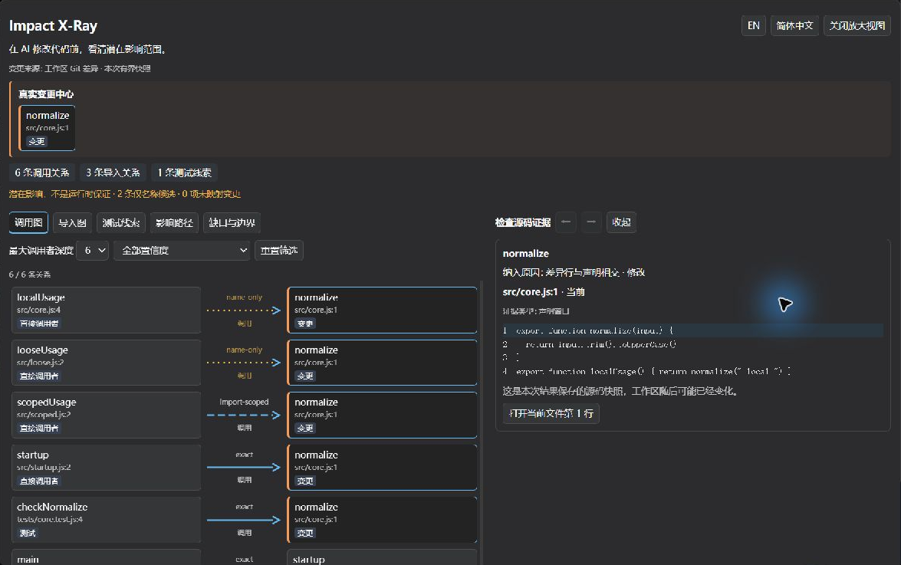
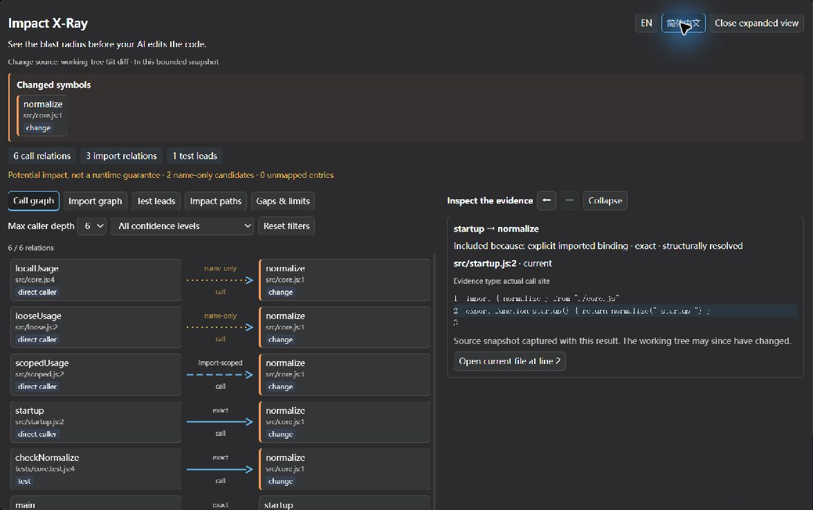

# Impact X-Ray — final candidate evidence

2026-10-21 · `feat/v0.11-impact-xray` · reviewed MVP `f867f2caf1bf62997f1bf71c215f79e90bc08b88`.

Candidate **`0.11.0-dev.1`, unpublished**. This extends the [MVP evidence](IMPACT_XRAY_MVP.md); it does not repeat or replace the proven analysis. Local, installed-runtime and current Desktop checks below passed. **RC READY is conditional on this revision's GitHub CI passing; the final status is recorded on [Draft PR #7](https://github.com/lemonxiny55/dsh-code-index/pull/7).** No Ready-for-review transition, merge, publication, tag or Release is part of this gate.

## 验收范围的调整

最初计划验证真实旧版 Desktop。官方 `0.2.0-rc.2` 安装包签名有效，单独解包、使用隔离 DSH_HOME 与 Electron 数据目录，仅加载必要核心和本插件。其 setup / main 页面实际出现，但两次通过宿主 `quitAndInstall` 更新流程退出，尚未操作 X-Ray。安装包 SHA256：`d61cd8882f8b8a1251144320493ad27920d15139503eba2465b9579eee720cfc`。没有修改宿主源码、第三方插件或绕过更新策略，也没有将启动/更新问题定为本插件缺陷。

**用户随后明确指示“让你在 0.2.1-rc2 里验证，我已经打开了”。** 因此本轮实机范围改为用户已打开的 `0.2.1-rc.2`，旧版不再继续启动。旧 RC 的 API 安装/ToolRuntime 矩阵仍然通过，但 **旧 Desktop 的 X-Ray UI 尚未验收**，不会用 API 源码检查冒称实机通过，也不删除或扩大原有 peer 支持。RC 判定只适用于这一最新约定的实机范围；旧版 UI 是保留风险。

## 首屏与实机操作

仅调整客户端标题区：突出真实 diff 的变更中心；显式选择仍标明“不证明实际修改”；直接统计已投影的调用/导入关系和测试线索，标明“本次有界快照”；持续显示 name-only 候选与未映射数量。线型说明收进可展开说明，减少重复文字，图行、方向、来源和原有布局保持不变。未修改关系分析算法或增加图库。

实际安装的 `dev.1` client/server 哈希与最终候选包一致。通过应用菜单正常退出、安装备份后的候选、重启，打开原来的真实工具会话；不是注入 metadata 或模拟卡片。沿用 MVP 五次实际工具调用及 82 个源码窗口审计，**本轮不宣称新增 Agent 调用**。

- 首屏显示 `normalize · src/core.js:1`、6 条调用关系、3 条导入关系、1 条测试线索、2 条仅名称候选，与原始结果相符。
- 节点点击显示 `startup` 声明；`startup → normalize` 箭头显示 exact、真实导入绑定、`src/startup.js:2` 和调用行。
- 黄色点线 `looseUsage → normalize` 显示 repository-wide name match / name-only / low confidence；namespace 调用保留 import-scoped。
- EN / 简体中文切换保留同一图和选择；当前源码可打开原生 `scoped.js` 预览，第 2 行实际可见，放大对话框正常退回。
- 重启后的真实结果回放、空图和 `../outside.js` 原始错误回退正常。未重做全部 MVP 已验收路径；原有展开、路径、边界等证据继续保留，客户端回归及完整安装矩阵重新执行。

[低置信度截图](assets/impact-xray-rc-en-name-only.png) · [import-scoped 截图](assets/impact-xray-rc-en-import-scoped.png) · [原生预览](assets/impact-xray-rc-native-preview.png) · [错误回退](assets/impact-xray-rc-error-visible-final.png) · [截图裁切/原始哈希](assets/impact-xray-rc-ui-evidence.json)。只裁切真实画面，没有生成或重绘 UI。

## 六文件内存差异复核

环境：Windows x64、Node 24.19.0、Ryzen 9 7940HX、物理内存 16,339,554,304 bytes。对照发布版 v0.10.2、候选仅分析、候选分析加 X-Ray。每个夹具/方式三次独立进程，轮换执行顺序，每次冷索引、三次分析；X-Ray 方式再执行三次投影。一次立即分析，一次在索引后相同地等待 1,000 ms，共 36 个进程。无强制 GC；记录当前 RSS、累计 peak RSS、heap、external 和 arrayBuffers。下面是等待对照组范围。

| 六文件 / 11 符号 / 760 源码 bytes | v0.10.2 分析 | 候选仅分析 | 候选 + X-Ray |
| --- | ---: | ---: | ---: |
| 冷索引 ms，3 次 | 177.72–213.59 | 174.98–189.71 | 188.49–198.41 |
| 分析 ms，9 次 | 0.25–3.49 | 0.25–3.38 | 0.21–3.39 |
| 投影 ms，9 次 | — | — | 3.28–7.68 |
| **索引后等待期间的累计峰值 MiB，尚未分析/投影** | 1289.21–1289.60 | 1289.48–1290.07 | 1289.30–1289.91 |
| 等待后当前 RSS MiB | 62.48–62.65 | 62.54–63.03 | 62.44–63.21 |
| 最后当前 RSS MiB | 62.97–63.23 | 63.01–63.50 | 63.17–63.84 |
| 最后 heap used MiB | 9.42–9.45 | 9.45–9.92 | 10.48–10.48 |

MVP 原来的 514 / 885 MiB 是不同运行时长结束时的累计峰值，不能直接相减视为 X-Ray 内存分配。立即组仍有明显波动；相同等待组在 **X-Ray 尚未执行时**，三个方式都观察到约 1.29 GiB 峰值、随后当前 RSS 回落。既有 `buildIndex` / extract / refgraph / source reader 与发布基线相同，分析结果哈希也一致，证据支持“已有索引/runtime 的延迟内存活动影响短观测窗口”，不支持“X-Ray 导致几百 MiB 新增占用”。**没有进一步声称已定位具体 V8/WASM 分配器原因或修复了旧引擎。** 投影仍有源码 IO 和 JS 分配；小样本与 GC 波动不能证明零成本或内存泄漏。

## 真实中等仓库

使用完整的 [Express v5.1.0](https://github.com/expressjs/express/tree/cd7d4397c398a3f3ecadeaf9ef6ac1377bd414c4) 固定提交 `cd7d4397c398a3f3ecadeaf9ef6ac1377bd414c4`，索引 **142 文件 / 586 符号 / 559,459 源码 bytes**。没有修改该仓库；明确选择 `lib/utils.js`，不是伪造 Git diff。用于真实代码上的分析/投影资源观测，不宣称生产任务速度或全覆盖。

| 指标 | v0.10.2 分析 | 候选仅分析 | 候选 + X-Ray |
| --- | ---: | ---: | ---: |
| 冷索引 ms，3 次 | 1295.40–1333.18 | 1306.99–1361.84 | 1293.07–1306.30 |
| 分析 ms，9 次 | 4.82–12.47 | 4.35–10.75 | 3.52–10.66 |
| 投影 ms，9 次 | — | — | 3.09–5.73 |
| 索引后累计峰值 MiB | 613.72–614.76 | 613.53–614.55 | 614.37–615.30 |
| 最后当前 RSS MiB | 77.07–77.71 | 76.37–76.68 | 77.19–77.97 |

每个夹具的分析输出在所有方式、所有样本中 SHA256 一致；Express 投影 metadata 8,227 bytes。内存与耗时是本机观测，不能跨语言/仓库线性外推。没有 FPS、渲染器 heap、准确率或 Token 节省结论。[完整原始数据与阶段内存](assets/impact-xray-rc-performance.json)。脚本 `scripts/impact-xray-rc-benchmark.mjs` 接收发布基线 dist 和真实仓库路径；设置 `XRAY_BENCH_SETTLE_MS=1000` 重现等待对照。

## 媒体与发布文档

[30 秒 MP4](assets/impact-xray-mvp.mp4) / [GIF](assets/impact-xray-mvp.gif) 再次完整解码通过，文件哈希保持不变。复核第 5、9 秒：前十秒已经显示真实 normalize 修改、调用者/测试和点击 exact 箭头后的真实源码/行号。保留正常速度、原裁切和真实操作顺序，不添加假 UI 或宣传性能。

素材来自 `dev.0` MVP；这次 `dev.1` 的更新首屏另附实机截图，README 和[中英发布准备说明](RELEASE_NOTES_v0.11.0.md) 均明确版本差异。开发候选本地安装与未来正式发布后的安装命令分开说明；修正 ArkTS 保留版本、旧兼容标题和历史安装示例，不提前宣称 v0.11.0 已发布。

## 最终本地门槛与候选包

- Node **22.23.3 / 24.19.0：各 253/253** 全量测试通过，typecheck、构建通过，两个运行时的 client/server 构建哈希一致。
- 最终同一 tgz：Node 22/24 × dsh-tools `0.2.0-rc.2` / `0.2.1-rc.2`，**四组实际安装 + ToolRuntime smoke 通过**。默认文本、Context Pack、多语言和三档来源回归保留。
- 包清单 **24 文件**；与已安装插件逐项哈希一致，包含构建产物、现有 grammar/许可证和脚本，不含 HANDOFF、资产录屏、测试或本地诊断数据。
- 依赖、devDependencies、engines、peer 范围、lockfile 和 grammar 未变化；server.js **184,901 bytes，与 MVP 相同**；client.js **62,174 bytes**。
- v0.10.2 压缩包 **415,815 → 460,843 bytes**，增加 **45,028 / 10.83%**；解包 3,308,573 bytes。

**候选包：** `dsh-code-index-0.11.0-dev.1.tgz`（仅本地打包，未发布）。

**SHA256：** `c61bd83b2be942a14eabdd911a35cb6d387aaaf9b56b1e27f81ce231473b8fdd`

[逐项清单、测试/日志/包哈希](assets/impact-xray-rc-validation.json)。GitHub CI 以 PR 本次提交的实际检查为准，不能用本地 JSON 冒称 CI 已通过。

## 剩余风险与停止点

1. 旧 Desktop 完整 X-Ray UI 未通过本轮实机验收；按用户最新指示停止旧版尝试。原 peer 声明不变，API/runtime 通过不能消除旧 UI 风险。
2. 底层解析/索引的瞬时大内存仍存在，UI 有界不等于整仓库资源有界；真实大仓库和 renderer 性能不能由这两个样本保证。
3. MVP 中已列明的静态分析、动态调用、历史关系、源码窗口/快照和测试候选限制继续适用。没有新分析算法或语义扩展。
4. 既有 profile 的 package.json、cordis.yml、lockfile 哈希未变；cordis.patch.yml 在用户同时操作 Desktop/模型设置期间发生变化。本代理没有直接写入或回滚该文件，也不声称所有 profile 哈希不变；未扩大到宿主配置诊断。
5. HANDOFF_PROMPT.md 未修改、未提交；宿主/第三方源码未改动。实机操作已结束，不再占用桌面。CI 成功后仅标记本约定范围的 **RC READY** 并停止，正式发布与合并仍需单独授权。

## English decision boundary

The candidate improves presentation only, preserves existing analysis/text/Context Packs, and passes the local Node 22/24 and four packed-runtime gates. Actual Desktop 0.2.1-rc.2 verified the installed candidate, replay, source selections, bilingual counts, native preview and error fallback. The user redirected Desktop testing to 0.2.1 after the isolated old app exited through its updater; **old Desktop X-Ray UI is not certified**. RC readiness is scoped to that updated instruction and requires this revision's CI success. PR #7 stays Draft; no publication or merge.
