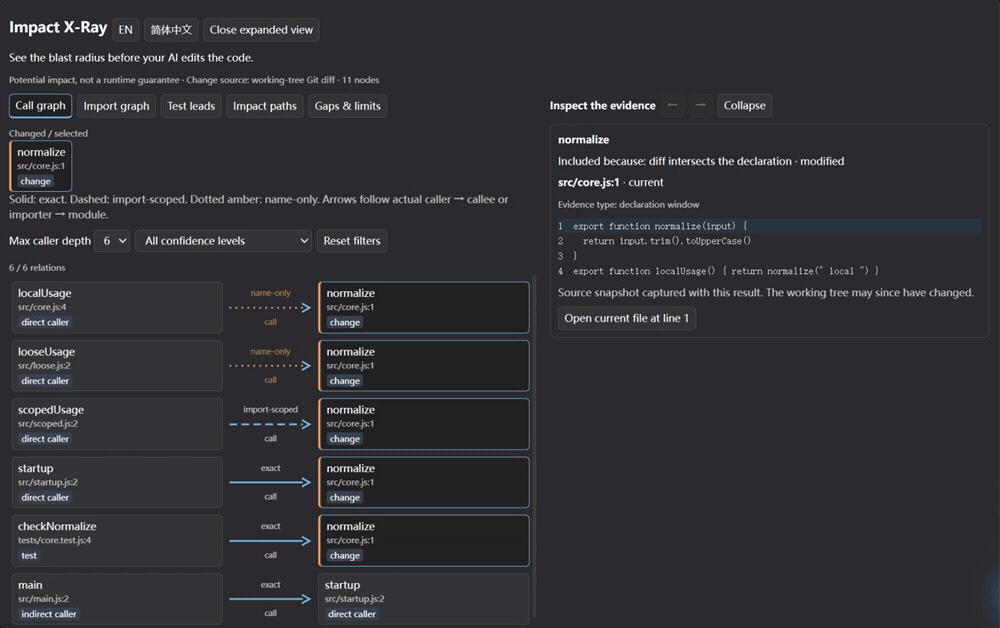
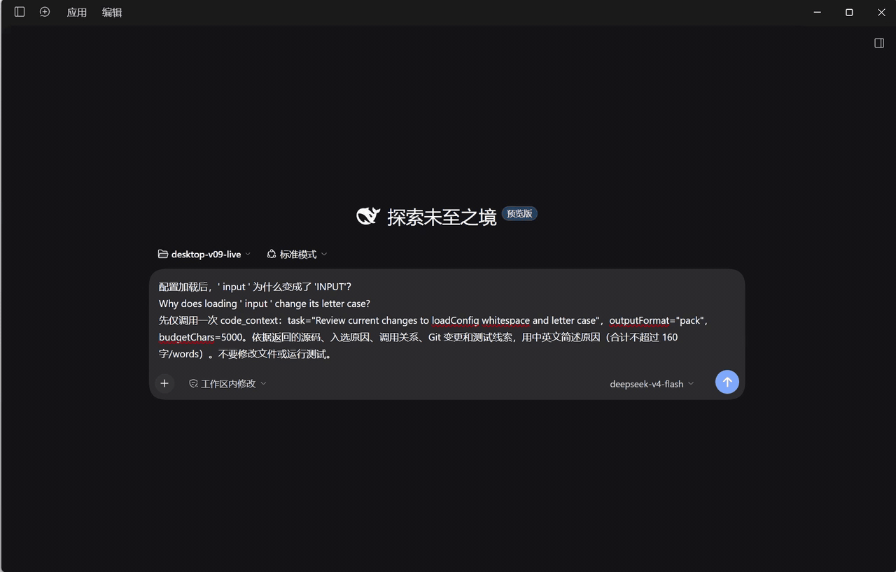
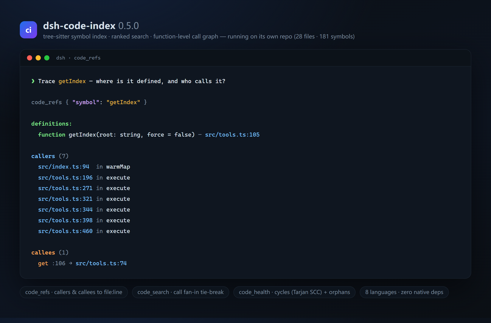

# dsh-code-index

[](https://www.npmjs.com/package/dsh-code-index)
[](https://github.com/lemonxiny55/dsh-code-index/actions)

English | [中文](README.zh.md) · [v0.14.0 Release](https://github.com/lemonxiny55/dsh-code-index/releases/tag/v0.14.0) · [npm v0.14.0](https://www.npmjs.com/package/dsh-code-index/v/0.14.0) · [CHANGELOG](CHANGELOG.md)

> **See the blast radius before your AI edits the code.**
>
> Local code intelligence for [DeepSeek Harness (DSH)](https://github.com/deepseek-ai/deepseek-harness) — inspect changed-symbol source, aliased/barrel callers, verification command leads, import cycles, and monorepo cross-package impact before letting an AI agent edit your repository.

- **Real-Repo Precision & Verification Leads (`v0.14.0` new):** Config-aware path aliases (`tsconfig.json`/`jsconfig.json`/`package.json#exports`/HarmonyOS `oh-package.json5`), bounded barrel re-exports (`maxReexportDepth = 3`), `Review Brief` `commandLead` suggestions (never executed), change-scoped `cycle-warning`, and monorepo `Cross-package impact`.
- **Review Brief:** Structured `{ text, brief }` change review via `code_change_context` (`outputFormat: "review"`) with explicit `Test Leads` and `Evidence Gaps`.
- **Impact X-Ray:** Interactive Desktop blast-radius map (`outputFormat: "xray"`) with clickable source evidence and cross-package summary.
- **Call Graph & Ranked Search:** Trace callers/callees (`code_refs`), ranked symbol lookup (`code_search`), and PageRank repo maps (`code_map`).
- **5,000-Char Hard-Budget Context Packs:** One `code_context` call delivers bounded, edit-ready source excerpts (default 5000 / 300–20000 JS chars) with provenance and explicit gaps.
- **100% Local, Zero Indexing API Key:** Tree-sitter WASM + on-disk mtime-incremental cache (schema 5) + isolated multi-worktree contexts.
- **9 Languages Including HarmonyOS ArkTS (`.ets`):** ArkTS, TypeScript, JavaScript, Python, Go, Rust, Java, C++, and C — pure WASM, no native build.

---

## Quick Start

Requires **Node ≥ 22** (validated on Node 22/24) and a compatible DSH profile with matched first-party DSH packages:

```sh
dsh plugin --profile desktop add dsh-code-index@0.14.0
```

Restart DSH Desktop after installation, then try asking your Agent:

> **"Run `code_change_context` with `outputFormat: "review"` and `budgetChars: 5000` on the current working tree, and summarize the changed symbols, static callers, test leads, and evidence gaps."**

Or try `code_context` on an existing bug:

> **"Use `code_context` to locate a config-loading bug, show the relevant source and callers, and identify likely tests."**

<details>
<summary>More install options: Web profile, local source build, peer dependencies & WSL symlink fix</summary>

### Web profile

```sh
npx @deepseek-ai/dsh@0.2.1-rc.2 plugin --profile web add dsh-code-index@0.14.0
npx @deepseek-ai/dsh@0.2.1-rc.2 web
```

You can also install against a matching `0.2.0-rc.2` profile from npm or a local checkout:

```sh
# from npm (prebuilt)
npx @deepseek-ai/dsh@0.2.0-rc.2 plugin --profile web add dsh-code-index@0.14.0

# or from a directory containing this checkout
npx @deepseek-ai/dsh@0.2.0-rc.2 plugin --profile web add ./dsh-code-index
```

Restart the Web UI (`npx @deepseek-ai/dsh@0.2.0-rc.2 web`) — startup logs confirm each tool:

```text
[dsh-code-index] plugin loaded
[dsh-code-index] registered tool: code_index
...
```

Verify the composed config without booting: `dsh --profile web --dump-config`.

### Local development build

Run at the repository root:

```sh
pnpm install
pnpm build
# then install into a web profile
dsh plugin --profile web add .
```

### Peer dependencies & compatibility history

Requires `dsh` (any install path — npx, npm, or source) and Node ≥ 22.

- **Declared peer requirements (retained from v0.12.0 in v0.13.0):** `@deepseek-ai/dsh-tools: >=0.2.0-rc.2 || >=0.2.1-rc.2 <0.2.2 || >=0.2.2-rc.1 <0.2.3` and optional `@deepseek-ai/cordis: ^4.0.1`.
- The explicit RC ranges fix normal npm peer resolution for the declared DSH 0.2.1 / 0.2.2 RC groups without `--force` or `--legacy-peer-deps`; this does not verify every future SDK or host.
- DSH host checks include prereleases, while npm uses its default prerelease rules; a version allowed to load is not necessarily verified. Keep DSH/`dsh-tools` and other first-party packages on a matched version group. The plugin API remains a preview API.
- **Compatibility history:** v0.10.0 pinned `0.2.0-rc.2`; v0.10.1 enumerated the then-supported groups; v0.11.2 broadened the host range; v0.12.0 added explicit RC ranges for npm peer resolution. The development dependency remains `0.2.0-rc.2` for backward API checks; it does not describe the SDK used in every runtime check.

### WSL → Windows checkouts

Running `pnpm install` from WSL against a checkout on `/mnt/c` leaves Linux-style symlinks that Windows Node cannot traverse (`Cannot find package 'web-tree-sitter'`, `EACCES`). Repair from the Windows side without reinstalling:

```sh
node.exe scripts\fix-wsl-links.mjs            # this repo's node_modules
node.exe scripts\fix-wsl-links.mjs C:\Users\you\.dsh\profiles\web   # a dsh profile install
```

It re-points every dead link at its real `.pnpm` store entry as a junction; safe to re-run (idempotent, reports `fixed: 0` when clean).

</details>

---

## What's New in v0.14.0: Real-Repo Precision & Verification Leads

Call `code_change_context` with `outputFormat: "review"` to get a bounded `{ text, brief }` review package before AI edits (default `text` and `xray` formats remain available):

```json
{"outputFormat":"review","budgetChars":5000}
```

| v0.14.0 Highlight | What You Get |
| --- | --- |
| **Path Aliases & Barrel Re-exports** | Resolves JSONC `tsconfig.json`/`jsconfig.json` (`extends`, `baseUrl`, `paths`), local `package.json#exports`, HarmonyOS `oh-package.json5`, and `export { ... } from` / `export * from` (`maxReexportDepth = 3`, cycle-guarded) with deterministic `via` notes. Multi-match wildcards downgrade strictly to `import-scoped` + `ambiguous-alias`. |
| **Verification Command Leads (`commandLead`)** | Deterministic minimal-scope test commands in `Review Brief` from `package.json` (Vitest/Jest), `pyproject.toml`, `go.mod`/`go.work`, and `Cargo.toml` — never auto-executed (`verification: "not-run"`); omitted with `verification-command-unavailable` when unknown. |
| **Change-Scoped `cycle-warning`** | Reuses Tarjan SCC over the alias-aware module graph in `review` mode to warn only on import cycles touching changed files. |
| **Monorepo `Cross-package impact`** | Maps `pnpm-workspace.yaml`, `package.json#workspaces`, `Cargo.toml`, `go.work`, and HarmonyOS `build-profile.json5` boundaries in `Review Brief` and `Impact X-Ray`, preserving the 300–20000 JS-char hard budget (`commandLead` trims first when tight). |

- **Notes & Evidence:** [v0.14.0 Release Notes](RELEASE_NOTES_v0.14.0.md) · [v0.14.0 Release Evidence](RELEASE_EVIDENCE_v0.14.0.md) · [v0.14.0 Engineering Plan](V0.14.0_PLAN.md) · [Review Brief Walkthrough (v0.13.0)](docs/development/v0.13.0/DEMO.en.md)

<details>
<summary>Review Brief budget, capture provenance & scope boundaries</summary>

- **Budget unit:** The full `{ text, brief }` JSON budget defaults to 5000 and is bounded to **300–20000 JavaScript characters**, not a model token limit; host overhead is excluded.
- **Evidence limits:** Candidate tests are not run, static relations do not prove runtime impact, and missing evidence is not evidence of absence. Repository metadata is a non-atomic observation; re-query after edits.
- **Symbol selection:** Obtain exact `symbols` IDs from `code_symbols`, or omit `symbols` to use the working tree diff.
- **Desktop capture provenance:** The [six v0.13.0 Desktop captures](docs/assets/v0.13.0/README.md) display real Host API results replayed in Desktop; they are labeled **Host API replay / no model call**, not real Agent UI interactions. See the [stable acceptance record](docs/development/v0.13.0/STABLE_ACCEPTANCE.zh-CN.md) for the separately scoped Agent and DSH rc.3 checks.

</details>

---

## See It in Action

### 1. Impact X-Ray — 30-Second Real Desktop Demo

A change to `normalize()` → inspect callers and a test lead → click a relationship to inspect the actual source location.



[Watch MP4](assets/impact-xray-mvp.mp4) · [Full-size GIF](assets/impact-xray-mvp.gif) · [Demo notes and reproduction](assets/impact-xray-mvp-demo.md) · [MVP report](IMPACT_XRAY_MVP.md) · [Install v0.14.0 from npm](https://www.npmjs.com/package/dsh-code-index/v/0.14.0) · [Project](https://github.com/lemonxiny55/dsh-code-index)

Ask the Agent to call `code_change_context` with `{"repoRoot":"/absolute/path/to/repo","outputFormat":"xray"}`, expand the tool result, choose **Expand view**, and click any arrow:

| Relationship | Display | Meaning |
| --- | --- | --- |
| `exact` | Solid | Structurally resolved under the existing index; not guaranteed runtime impact |
| `import-scoped` | Dashed | Import-scope evidence, with the original reason retained |
| `name-only` | Dotted amber | Name candidate; inspect and verify manually |

<details>
<summary>Impact X-Ray recording provenance, presentation caps & local reproduction</summary>

- **Recording provenance:** The recording is an actual DSH Desktop interaction with the `0.11.0-dev.0` MVP in Desktop 0.2.1-rc.2. It shows existing analysis and source evidence; it is not a model-driven Agent latency or success claim. See [recording provenance](assets/impact-xray-mvp-demo.md).
- **Interactive view scope:** Impact X-Ray is an interactive view of the existing `code_change_context` analysis and source reader; it does not add an impact-analysis engine. Start from a Git diff or an explicitly selected file/symbol; inspect callers, import dependents, paths, and candidate tests. Click a relationship to inspect its provenance and available source snapshot at a file and line. Treat candidates as leads: `name-only` matches can be uncertain, and a test lead does not prove coverage or failure. Relationships are static evidence, not guaranteed runtime impact.
- **UI behavior & arrow semantics:** The UI follows the host language and also offers English / 简体中文. Call graph, import graph, test leads, impact paths, and gaps each have their own tab. Depth/confidence filters and local expansion only reveal the bounded snapshot; they do not fetch more analysis. Arrows retain actual caller → callee or importer → module endpoints. Test conventions never become invented function-call arrows. Whole-path confidence retains the weakest relation. Saved source is a snapshot; rerun after edits. Deleted declarations use baseline source when available and do not offer a misleading current-file preview.
- **Presentation caps:** The presentation caps at **32 nodes, 48 arrows, 12 paths, 8 test/import leads each**, 900 characters per source window, and 96,000 UTF-8 bytes of metadata. Call relationships reserve at most 24 symbol nodes / 32 arrows. Optional X-Ray text caps at 24,000 JS characters; the default canonical text and `code_context` packs remain unchanged. The existing index/reference analysis runs before projection, so these UI caps are not a constant-memory guarantee for large repositories. See measured costs and host compatibility methods in the [MVP report](IMPACT_XRAY_MVP.md).
- **Reproduce the real demo locally** (refuses to overwrite an existing directory):

```sh
npm run build
node scripts/impact-xray-demo.mjs /absolute/path/to/new-demo-repo
```

The script commits a six-source-file baseline and changes `normalize()` from trimming to uppercase conversion. Its baseline Node test passes; the edited test intentionally fails. `looseUsage` deliberately lacks an import, so its `name-only` relation remains uncertain.

</details>

### 2. `code_context` — 42-Second Bug Hunt in DSH Desktop

**Why did loading `' input '` produce `'INPUT'`?** One real `code_context` call returned `loadConfig` at `src/config.ts:1–3`, its callers, Git additions/modifications/deletions, and a likely test with inclusion reasons and provenance in **2347/5000 characters** — letting the Agent pinpoint `.toUpperCase()`.



[Watch MP4](assets/desktop-agent-v090.mp4) · [Recording notes and provenance](assets/desktop-agent-v090.md) · [Actual tool-card evidence](assets/desktop-agent-v090.evidence.json) · [Bilingual terminal replay](assets/agent-context-demo.md) · [30-second local tool demo](assets/context-pack-demo.html)

<details>
<summary>Recording provenance, Context Pack budget model & earlier code_refs example</summary>

- **Recording provenance:** This is **actual desktop footage recorded on 2026-10-08**, using the installed v0.9.0 plugin and a tiny demonstration repository. Only DSH is shown; waiting was cut and audio removed. No files were edited or tests run. The clip is not a latency measurement or a claim that a fix/tests succeeded.
- **Additional replays:**
  - The earlier [bilingual terminal replay](assets/agent-context-demo.md) remains available as a separate, clearly labeled replay of audited 2026-10-05 Agent records (showing external-edit freshness and a 500-character signature-only fallback).
  - The earlier [30-second local tool demo](assets/context-pack-demo.html) remains available and can be reproduced with `pnpm build`, then `node scripts/context-pack-demo.mjs`. It is a separate Context Pack demo, not the Impact X-Ray Desktop recording above.
- **How `code_context` builds edit-ready Context Packs:**
  - **Source within budget:** complete declarations, then whole-line windows, then explicit signature-only fallback. Overlapping source lines are deduplicated; current and baseline excerpts stay separate.
  - **One selected pack:** text and opt-in structured output (`outputFormat: "pack"` returning the exported `ContextPack` DTO) consume the same final ContextPack. Both fit within the default 5000-character cap (`budgetChars` normalized to 300–20000 JavaScript string characters, not tokens or UTF-8 bytes; `maxFiles` defaults to 12, `maxSymbols` to 10). Code is never cut mid-line to fill the cap. Very small budgets can leave only signatures or gaps; a repository identity that cannot fit produces an explicit error. Task display is summarized to 120 characters without affecting routing.
  - **Routing & ranking:** routes change, symbol, architecture, test, exploration, and ambiguous tasks. Deterministic camel/snake terms plus file/path/signature terms rank candidates; exact named symbols are retained before selection. Strong primary seeds find likely tests even on a clean tree. Graph neighborhoods are bounded. BM25 is not used.
  - **Evidence & Git classification:** inclusion reasons are separate from `exact` / `import-scoped` / `name-only` relationship provenance; no probability or confidence estimate is invented. `items` carry `file/startLine/endLine/side/ref/mode/code`, `reason`, and `resolution/provenance`; `budget.usedChars` accounts for text and `budget.packChars` for serialized JSON; render with `renderContextPack`; no hidden candidate list is exposed. Git changes with a readable, frozen baseline commit classify declarations as added/modified/deleted (reliable file renames remain supported; unknown/ambiguous structural identity is `unclassified`; symbol renames are not guessed). Explicit `files`/`symbols` in `code_change_context` remain selection modes, not proof of a Git modification.
- **Earlier `code_refs` call-graph output** (an earlier real example of the existing tool, not a v0.9 Context Card):



</details>

---

## Tools at a Glance

| Tool | Purpose |
| --- | --- |
| `code_index` | Status / (re)build the index for the current workspace |
| `code_symbols` | List symbols (functions, classes, interfaces, types, methods…) with `file:line` — filtered by name, path, kind, exported |
| `code_search` | Ranked lookup: exact > prefix > substring > subsequence-fuzzy, exports first, relevance score + `file:line` |
| `code_map` | Bounded ranked repo map (top files by symbol density + import-graph PageRank, key symbols + lines) |
| `code_refs` | Trace a symbol through the call graph: callers (who calls it) and callees (what it calls), resolved to `file:line` |
| `code_change_context` | Start from the working-tree or an explicit diff and return changed symbols, callers, import dependents, bounded impact paths, and likely tests (`text`, `review`, or `xray`) |
| `code_context` | Edit-ready ContextPack: bounded source, reasons, relationships, changes/tests, gaps, and a hard budget; text by default (`pack` opt-in) |
| `code_health` | Opt-in (`codeHealth: true`): circular dependencies (import cycles) and orphan modules |

Plus an optional **auto-injected system prompt section** (`code-index:repo-map`, order 60): a compact ranked map selected from the active DSH session workspace. Set `autoInject: false` to disable and rely on `code_map` only.

No API key is needed to *index* (the model must of course be configured to call the tools). Example prompts:
- *"Which repo are we in — run `code_map` first."*
- *"Find every function whose name contains `parse` and where it lives."*
- *"List the exported symbols in `src/core`."*
- *"What changed in the working tree, who calls it, and which tests are likely affected?"*
- *"Fix duplicate configuration loading during startup."* (the router selects the smallest useful context automatically)

---

## Supported Languages & Multi-Worktree Isolation

### 9 Languages via Tree-sitter WASM (No Native Build)

**ArkTS, TypeScript, JavaScript, Python, Go, Rust, Java, C++, and C** (`.ets .ts .tsx .mts .cts .js .jsx .mjs .cjs .py .pyi .go .rs .java .cpp .cc .cxx .c++ .hpp .hxx .hh .h .ipp .tpp .inl .c`).

- **HarmonyOS ArkTS (`.ets`)**: Uses a dedicated, pinned WASM parser bundled with the package to index `struct` components, methods, fields, and decorators (`@Component`, `@ComponentV2`, `@State`, `@Local`, `@Builder`, etc.), trace statically identifiable ETS/TS references, and return real source in bounded Context Packs.
- **C / C++**: Symbol extraction resolves names through the declarator chain (templates, qualified `ns::name` definitions, in-class methods), and `#include "…"` specifiers feed the repo-map reference graph.
- **Extensible seam**: `src/extract.ts` + grammars provide the symbol-provider seam for future languages or embeddings.

### Isolated Worktrees & Live Freshness

```text
Open repo A → search finds A's symbols
Switch to repo B → search finds B's symbols, not A's
Edit files outside DSH → the next query sees the change
Switch back to A → A's context is still isolated
```

Each Git worktree gets its own on-disk index and change state (up to 4 contexts retained by canonical real path). The plugin builds lazily on first use, refreshes incrementally by mtime, honors root and nested `.gitignore` rules (including the v0.9.1 directory whitelist fix), and watches active session projects for external add/edit/delete changes without manual rebuilds.

---

## Validation Boundaries, Technical Specs & Release History

<details>
<summary>Validation boundaries & historical release acceptance (v0.14.0 / v0.13.0 / v0.12.0 / v0.11.1 / v0.10.0)</summary>

### v0.14.0 — Real-Repo Precision & Verification Leads

- **Release:** [v0.14.0 Release Notes](RELEASE_NOTES_v0.14.0.md) · [v0.14.0 Release Evidence](RELEASE_EVIDENCE_v0.14.0.md) · [CHANGELOG](CHANGELOG.md)
- **Verification scope:** Verified locally via `pnpm typecheck`, 36 Vitest suites (`pnpm test`), production ESM/DTS/client builds (`pnpm build`), and clean tarball installation + `ToolRuntime` smoke (`pnpm release:smoke`). No new Desktop Electron UI run or model-driven Agent run is claimed for `v0.14.0`.

### v0.13.0 — Review Brief

- **Release:** [GitHub Release v0.13.0](https://github.com/lemonxiny55/dsh-code-index/releases/tag/v0.13.0) · [npm v0.13.0](https://www.npmjs.com/package/dsh-code-index/v/0.13.0) · [Release Notes](RELEASE_NOTES_v0.13.0.md)
- **Desktop captures:** The [six v0.13.0 Desktop captures](docs/assets/v0.13.0/README.md) display real Host API results replayed in Desktop; they are labeled **Host API replay / no model call**, not real Agent UI interactions.
- **Acceptance scope:** See the [stable acceptance record](docs/development/v0.13.0/STABLE_ACCEPTANCE.zh-CN.md) for the separately scoped SDK, Desktop, Agent, and DSH rc.3 checks.

### v0.12.0 — Reliable Context & Evidence (2026-11-09)

- **Release:** [GitHub Release v0.12.0](https://github.com/lemonxiny55/dsh-code-index/releases/tag/v0.12.0) · [npm v0.12.0](https://www.npmjs.com/package/dsh-code-index/v/0.12.0)
- **Changes retained in v0.13.0:**
  - Deterministic Chinese task routing, path-aware identifier detection, and source-first candidate selection improve Context Packs while retaining English task regressions.
  - Optional **Evidence Summary** (`ContextPack.evidence`) describes indexed-file diagnostics, static relationship grades, candidate tests, and detected gaps. `parsed` is not semantic completeness; zero static callers does not prove there are no callers.
  - Evidence may be compacted or omitted under the same text/JSON budget. Missing optional evidence means **not provided**, not "no gaps." Default 5000 and 300–20000 character bounds remain unchanged.
  - Test associations are leads, not execution, passing tests, or verified coverage. Static relationships are not guaranteed runtime behavior.
  - npm peer compatibility is fixed for the declared DSH 0.2.1 / 0.2.2 RC groups under normal npm resolution, without `--force` or `--legacy-peer-deps`; this does not verify every future SDK or host.
- **Historical validation records:** The [candidate integration record](docs/development/v0.12.0/INTEGRATION.zh-CN.md), [M2 evidence contract](docs/development/v0.12.0/M2.zh-CN.md), and [final release-readiness checks](docs/development/v0.12.0/RELEASE_READINESS.zh-CN.md) retain their original methods, failures, and limits. Their pre-publication status describes that stage; the [published release record](https://github.com/lemonxiny55/dsh-code-index/releases/tag/v0.12.0) records publication and public-install verification.
- **Validation boundaries:** Public-install verification used SDK 0.2.2-rc.1 / Cordis 4.1.0 (8 tools registered, 7 pipeline calls passed, no registrations after disposal). This was SDK/runtime smoke, not a repeated Desktop UI gate. Earlier Desktop 0.2.2-rc.1 checks covered graph/text rendering; extra edge-click interactions were tested in Web. Two focused real-Agent rechecks completed with a temporary 8192-token cap and only the requested code tools; they do not establish unrestricted shell access, arbitrary task success, or model/network reliability.

### v0.11.1 — Impact X-Ray Verification

- **Historical verification scope:** Full X-Ray UI verified in Desktop 0.2.1-rc.2; Web/Host rc.3 verified for all eight tools and X-Ray (no model-driven Agent run). Desktop 0.2.0-rc.2 passed installation and ToolRuntime checks, not full X-Ray UI. Keep each host's first-party packages on the same declared version. See [v0.11.1 evidence and limits](RELEASE_EVIDENCE_v0.11.1.md).

### v0.10.0 — ArkTS Historical Checks & v0.9.1 Gitignore Fix

- Introduced in [v0.10.0](https://github.com/lemonxiny55/dsh-code-index/releases/tag/v0.10.0) and retained in v0.13.0: the v0.10.0 installed package passed real DSH Desktop Agent verification and Node 22/24 release checks; those are historical checks, not a new v0.12.0/v0.13.0 ArkTS acceptance run. Partial or failed parses report bounded diagnostics.
- See [release evidence](RELEASE_EVIDENCE_v0.10.0.md), [ArkTS PoC](ARKTS_POC_v0.10.0.md), and [the bilingual announcement](assets/v0.10.0-announcement.md). The v0.9.1 Gitignore directory whitelist fix remains included.

</details>

<details>
<summary>Static analysis boundaries, ArkTS scope & known limitations</summary>

### Static analysis & runtime boundaries

- Static relationships (`exact`, `import-scoped`, `name-only`) are index-level evidence, not guaranteed runtime impact. Zero static callers does not prove there are no callers.
- Test associations (`Test Leads`) are candidate leads, not test execution, passing results, or verified coverage.
- `parsed` means syntax extraction completed, not that the index contains every semantic reference.
- Missing optional evidence or omitted fields mean **not provided**, not "no gaps" or evidence of absence.
- Repository metadata (root, HEAD/base, dirty status, index/metadata timestamps) is a non-atomic observation; re-query after editing.
- `code_change_context` defaults to the current Git working tree against `HEAD` and also accepts an inline unified diff, repo-relative `files`, or stable `symbols` IDs; deletions and renames use the baseline ref when available, and untracked non-ignored files are included in working-tree mode.

### ArkTS scope and limits

- Supports syntax, static code context, local `oh-package.json5` relative dependencies (`Index.ets` default entry), `build-profile.json5` multi-module workspace boundaries, and bounded ETS/TS re-export traversal (`maxReexportDepth = 3`), without full HarmonyOS SDK semantics, `oh_modules` third-party source parsing, or state-update/UI rerender graphs.
- Components declared with `struct` appear as `kind: class`, signature `struct Name`. Methods, fields, global functions, classes/interfaces/types/enums, and module variables have stable qualified IDs, owners, and source line ranges. Decorators (`@Component`, `@ComponentV2`, `@State`, `@Local`, `@Builder`, etc.) are retained as metadata and included in the definition's source range.
- `build()` and nested declarative UI blocks parse as ArkTS. Local components and explicit ETS/TS imports feed symbols, search, map, references, change context, and Context Packs. `@Extend` metadata and UI attribute chains are excluded from call relationships. Bare capitalized calls in UI bodies have no global-name or imported-module fallback; unbound SDK components (`@ohos.*` / `@kit.*`) cannot acquire unrelated same-named project targets. Ordinary callback/business calls retain existing provenance. `code_refs` uses binding-aware candidates for ArkTS call sites.
- Relative and local `oh-package.json5` mixed ETS/TS imports work when the target is statically unique. Extensionless stems with both ETS and another source file stay unresolved; ambiguous wildcards downgrade to `import-scoped` with `ambiguous-alias`. Default imports remain `import-scoped`; no SDK typing, state-update, or UI rerender semantics are inferred. Unbound/global custom UI components may therefore have no relationship edge. Syntax acceptance does not prove valid ArkTS or HarmonyOS runtime behavior.
- Each indexed file records `parsed`, `partial`, or `failed` syntax/read status, ERROR/MISSING counts, and at most three issue locations. Unreliable ArkTS declarations are omitted rather than assigned misleading IDs. `code_index` reports a bounded incomplete-index summary, and Context Packs/change context carry gaps within their existing budgets. Cache schema 5 rebuilds older caches automatically and invalidates on config mtime changes; source bodies remain unpersisted.
- Grammar: [harmony-contrib 0.3.0](https://github.com/harmony-contrib/tree-sitter-arkts), ABI 14, unchanged npm WASM bundled with its MIT notices. Consumer installation requires no native ArkTS addon. See [Asset provenance](grammars/README.md).

### Known limitations

- **web-tree-sitter pinned to `^0.25` (ESM)** — the 0.25 line uses ESM named exports (`Language`/`Query`); this pairing with `tree-sitter-wasms` static builds is verified working under Node ≥ 22/24.
- Auto-injected maps use DSH's system-prompt assembly context for the active session. Agentless assembly falls back to the DSH process working directory. A newly accessed project may have an empty map on its first prompt while indexing completes; following assemblies receive its map.
- The watcher starts only for projects accessed by a tool and is disposed with the plugin. With `externalWatch: false`, per-call metadata scans still detect ordinary mtime changes.
- Large monorepos still require a directory metadata scan on each tool call. File parsing is incremental, but scan latency depends on repository size and storage speed.
- Function-local variables are excluded. Module declarations and class members are indexed; a parser/graph is not a type checker.
- Source reads reject files changed after the index snapshot, paths resolving outside the root, and current files over 1 MB. Signature-only fallbacks and gaps identify missing evidence; likely tests are leads, not proof of coverage.

</details>

<details>
<summary>Configuration, how it works & local development</summary>

### Configuration

Options are passed as the plugin row's `config` in the profile patch (defaults apply if omitted; existing full/compact surfaces and v0.8 configuration remain supported):

```yaml
# $DSH_HOME/profiles/<name>/cordis.patch.yml — a bare row overrides by id.
- id: code-index
  config:
    excludeDirs: [generated, playground]
    mapTopFiles: 30
    mapMaxChars: 4000
    autoInject: true
    toolSurface: full
```

| Key | Default | Meaning |
| --- | --- | --- |
| `excludeDirs` | `[]` | Extra directory names appended to built-in excludes. Matching is by exact path component; glob patterns such as `secrets/**` are not supported. |
| `mapTopFiles` | `24` | Max files in a ranked map |
| `mapMaxChars` | `3200` | Hard cap on rendered map characters |
| `mapTtlMs` | `60000` | Refresh interval for the auto-injected map (ms, min 1000) |
| `autoInject` | `true` | Register the system prompt section |
| `codeHealth` | `false` | Register the `code_health` tool (cycles / orphan modules) |
| `toolSurface` | `full` | Experimental `compact` mode exposes `code_index`, `code_context`, and enabled `code_health`; `full` preserves all tools |
| `externalWatch` | `true` | Watch source files in active project contexts for external edits |
| `watchDebounceMs` | `120` | Coalesce watcher events before refreshing affected files (minimum 20 ms) |

### How it works

- **Index build & config resolution** (`src/buildIndex.ts`, `src/alias.ts`, `src/workspace.ts`): recursive scan (excludes applied), per-file tree-sitter extraction (`src/extract.ts`), lightweight alias & workspace manifest normalization (`tsconfig`/`jsconfig`/`package.json`/`oh-package.json5`/`pnpm-workspace.yaml`/`Cargo.toml`/`go.work`/`build-profile.json5`), JSON cache (schema 5) under `<repo>/.dsh-code-index/`, incremental refresh by source & config mtime (no source bodies persisted).
- **Search** (`src/search.ts`): pure scoring — exact `1` / prefix `0.8` / substring `0.5`, export boost, name order tiebreak.
- **Repo map** (`src/repomap.ts`): personalized PageRank over the import graph (teleport = per-file density share, so hub files that are themselves imported by other hubs rise above flat in-degree counting), seeded by the density-aware file score (class/interface/function weighted, test paths damped), top-N files, per-file symbol cap, hard char truncation.
- **Call graph** (`src/refgraph.ts`): call sites extracted per file (per language, with their enclosing function) resolve through local scopes, configured aliases, and bounded barrel re-exports (`maxReexportDepth = 3`, cycle-guarded) into callers and callees — `code_refs` exposes this directly, and `code_search` uses call fan-in as a ranking tie-break.
- **Change context & Review Brief** (`src/change-context.ts`, `src/review-brief.ts`, `src/test-leads.ts`): maps Git hunks to stable symbols, follows bounded provenance-labeled callers, import dependents (incl. reverse barrel chains), entry paths, cross-package summaries, changed import-cycle warnings, and deterministic static `commandLead` test suggestions without executing tests.
- **ContextPack** (`src/context.ts`, `src/context-pack.ts`, `src/source-excerpts.ts`): ranks task candidates, reads ephemeral source evidence, selects a final DTO under text/JSON budgets, then renders only selected items.
- **Health** (`src/health.ts`): Tarjan SCC over the import graph yields circular dependencies; orphan-module detection lists symbol-bearing files with no inbound or outbound imports (entry points and tests excluded).
- **Workspace resolution**: each tool resolves the session cwd (`agent.session.header.cwd`) and walks up to the nearest `.git` (bounded — a directory without a repo marker is never indexed).
- **Project contexts** (`src/repo-context.ts`): canonical real paths identify separate worktrees; up to four contexts are retained. Each tool call scans current metadata and reparses only changed files, while the watcher refreshes dirty files after a bounded debounce.
- **Ignore handling**: Git ignore rules from root and nested `.gitignore` files are applied to indexing. `excludeDirs` remains a list of exact directory names, not glob patterns.

### Development

```sh
pnpm install
pnpm test        # vitest — extractor, scan, cache, search, repo map, call graph, health
pnpm typecheck
pnpm build       # tsup → dist/index.js (ESM, external deps)
pnpm build && pnpm release:smoke # pack, clean-install the tarball, boot the plugin, and exercise core tools
```

The benchmark harness under `bench/` compares stock DSH, the published 0.5 baseline, the v0.6 change-aware treatment, and the v0.7 task-aware treatment. It records task completion, input tokens, tool calls, turns, and wall time; it does not invent missing provider usage. The repository contains infrastructure and sample tasks, not measured performance claims.

</details>

---

## Feedback & License

Used `dsh-code-index`? Tell me what helped, what broke, or what context it missed. Reply in the [official DSH plugin discussion](https://github.com/deepseek-ai/deepseek-harness/discussions/5623), or use the [feedback issue form](https://github.com/lemonxiny55/dsh-code-index/issues/new?template=feedback.yml) if issue submissions are enabled for the repository.

To make a report actionable, include the approximate repository size and languages, the task you tried, the context you expected, and what the agent actually received. Mention whether project switching, a worktree, or an external file edit was involved. Please do not include private source code, credentials, or API keys.

**License:** [MIT](LICENSE). Not affiliated with DeepSeek; built on the public `dsh` plugin surface.
