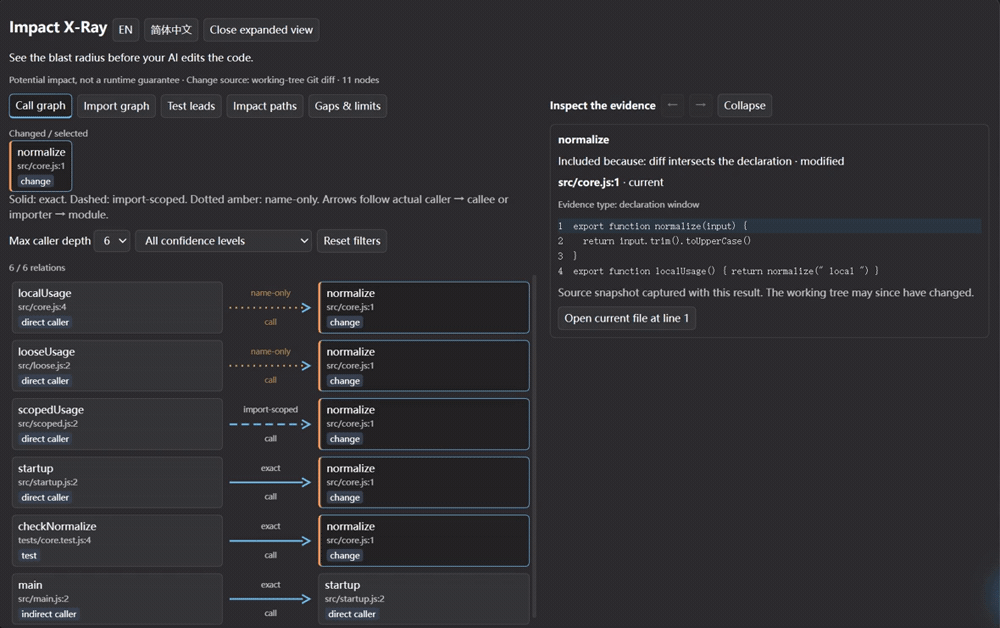
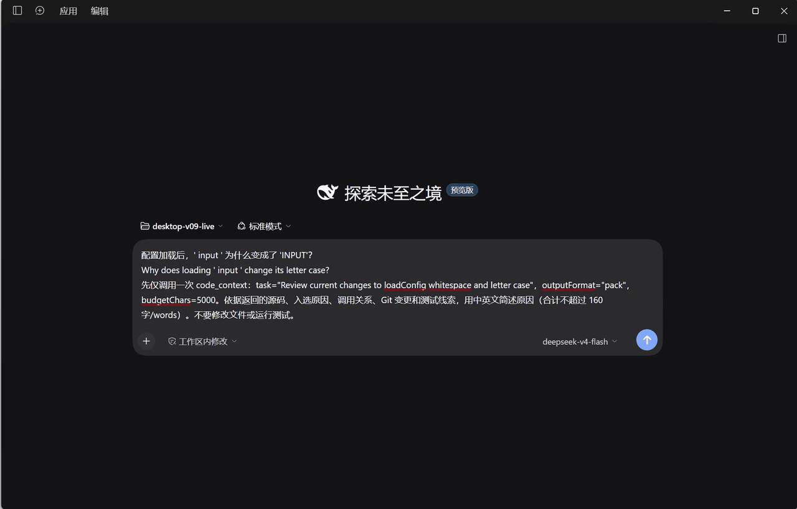
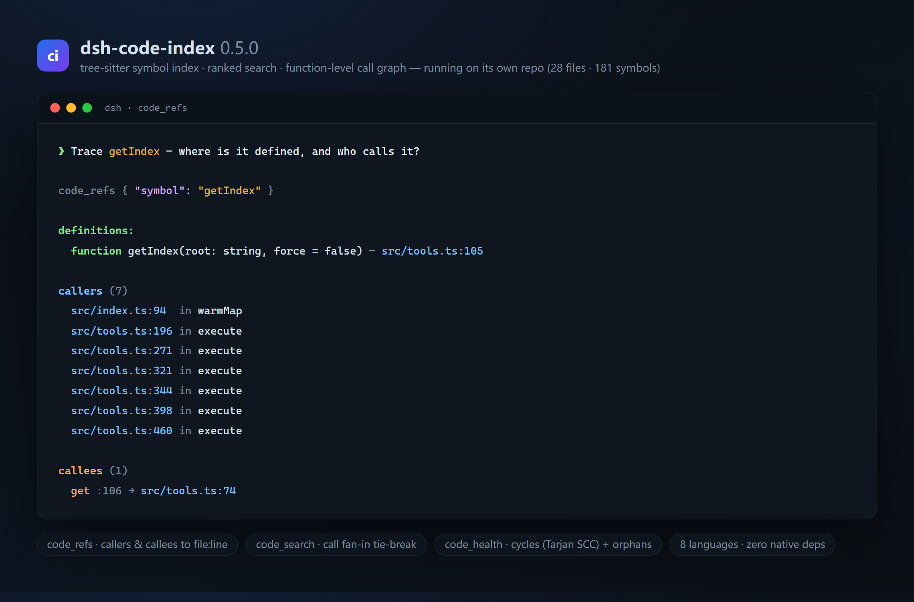

# dsh-code-index

[](https://www.npmjs.com/package/dsh-code-index)
[](https://github.com/lemonxiny55/dsh-code-index/actions)

English | [中文](README.zh.md)

**v0.11.0 — Impact X-Ray.** See the potential blast radius before AI edits code, then inspect each relationship against real source evidence. The 30-second recording shows the real `0.11.0-dev.0` MVP; the dev.1 first-screen change-center and uncertainty improvements are shown in separate [real Desktop screenshots](IMPACT_XRAY_RC.md#first-screen-and-visual-evidence). The release preserves existing `code_change_context` analysis and `code_context` packs.

**Supported Desktop versions**

The compatibility support introduced in [v0.10.1](https://github.com/lemonxiny55/dsh-code-index/releases/tag/v0.10.1) remains: only DSH/dsh-tools `0.2.0-rc.2` and `0.2.1-rc.2` host groups are supported. Keep each host's first-party packages on the same version.

## Impact X-Ray

**See the blast radius before your AI edits the code.**

- **Before AI edits your code:** start from a real working-tree Git diff, a supplied diff, or an explicitly labeled file/symbol selection.
- **See what may break:** inspect changed declarations, direct callers, indirect paths, module imports and candidate tests.
- **Inspect the evidence:** select a node or arrow to see its reason, provenance, file, line and actual source snapshot. Expand the view for a graph and evidence side by side; open current files in Desktop's native preview.
- **Know what remains uncertain:** dotted amber `name-only` candidates, import scope, unmapped ranges, missing source and truncation stay visible. A test lead does not prove coverage or failure.

This is an interactive presentation of the existing `code_change_context` analysis, with source from the existing reader. It does not introduce a new impact-analysis engine.



[Actual recording and reproduction notes](assets/impact-xray-mvp-demo.md) · [Release evidence and remaining limits](RELEASE_EVIDENCE_v0.11.0.md) · [Bilingual release notes](RELEASE_NOTES_v0.11.0.md)

The recording shows the real `dev.0` MVP; its first 10 seconds show the changed function, caller/test lanes and source-backed exact relationship. The `dev.1` first-screen improvements are documented separately with actual Desktop screenshots; the video has not been represented as a recording of those later header changes.

Install v0.11.0 into an existing supported Desktop profile with Desktop's bundled CLI:

```sh
dsh plugin --profile desktop add dsh-code-index@0.11.0
```

Restart Desktop after installation. For local development, use Node 22/24 and pnpm 11. Desktop 0.2.1-rc.2 received full UI verification. Desktop 0.2.0-rc.2 passed installation and ToolRuntime checks; its full Impact X-Ray UI was not validated. The peer range remains unchanged. See the release evidence for actual methods, performance observations and limitations.

Ask the Agent to call `code_change_context` with:

```json
{"repoRoot":"/absolute/path/to/repo","outputFormat":"xray"}
```

Expand the tool result, choose **Expand view**, and select an arrow. The UI follows the host language and also offers English / 简体中文. Call graph, import graph, test leads, impact paths and gaps each have their own tab. Depth/confidence filters and local expansion only reveal the bounded snapshot; they do not fetch more analysis.

| Relationship | Display | Meaning |
| --- | --- | --- |
| `exact` | Solid | Structurally resolved under the existing index; not guaranteed runtime impact |
| `import-scoped` | Dashed | Import-scope evidence, with the original reason retained |
| `name-only` | Dotted amber | Name candidate; inspect and verify manually |

Arrows retain actual caller → callee or importer → module endpoints. Test conventions never become invented function-call arrows. Whole-path confidence retains the weakest relation. Saved source is a snapshot; rerun after edits. Deleted declarations use baseline source when available and do not offer a misleading current-file preview.

The presentation caps at **32 nodes, 48 arrows, 12 paths, 8 test/import leads each**, 900 characters per source window and 96,000 UTF-8 bytes of metadata. Call relationships reserve at most 24 symbol nodes / 32 arrows. Optional X-Ray text caps at 24,000 JS characters; the default canonical text and `code_context` packs remain unchanged. The existing index/reference analysis runs before projection, so these UI caps are not a constant-memory guarantee for large repositories. See the measured costs and host compatibility methods in the [MVP report](IMPACT_XRAY_MVP.md).

Reproduce the real demo without overwriting an existing directory:

```sh
npm run build
node scripts/impact-xray-demo.mjs /absolute/path/to/new-demo-repo
```

The script commits a six-source-file baseline and changes `normalize()` from trimming to uppercase conversion. Its baseline Node test passes; the edited test intentionally fails. `looseUsage` deliberately lacks an import, so its name-only relation remains uncertain.

Give your [DeepSeek Harness](https://github.com/deepseek-ai/deepseek-harness) agent the bounded source context it needs to start a code task. One `code_context` call selects primary declarations, strong callers/callees, imports, current changes, and likely tests, with exact source ranges and reasons for inclusion. When evidence is missing, the pack says so.

- **Source within budget:** complete declarations, then whole-line windows, then explicit signature-only fallback. Overlapping source lines are deduplicated; current and baseline excerpts stay separate.
- **One selected pack:** text and opt-in structured output consume the same final ContextPack. Both stay within the default 5000-character cap.
- **Evidence you can inspect:** inclusion reasons are separate from `exact` / `import-scoped` / `name-only` relationship provenance. No probability or confidence estimate is invented.
- **Local and current:** isolated repo/worktree indexes, external add/change/delete freshness, no external indexing API key. Existing full/compact surfaces and v0.8 configuration remain supported.

Introduced in [v0.10.0](https://github.com/lemonxiny55/dsh-code-index/releases/tag/v0.10.0) and retained in v0.11.0: ArkTS `.ets` files use a dedicated, pinned parser to find component structs, methods, fields and decorators, navigate statically identifiable ETS/TS references, and retrieve actual source in bounded Context Packs. The installed package passed real DSH Desktop Agent verification and Node 22/24 release checks. Partial or failed parses report bounded diagnostics.

This supports syntax and static code context, without full HarmonyOS SDK semantics, HAR/module-alias resolution or state-update/UI rerender graphs. See [release evidence](RELEASE_EVIDENCE_v0.10.0.md), [ArkTS PoC](ARKTS_POC_v0.10.0.md) and [the bilingual announcement](assets/v0.10.0-announcement.md). The v0.9.1 Gitignore directory whitelist fix remains included.

## On this page

- [🚀 Quick start](#quick-start)
- [🧭 Project isolation and live updates](#project-isolation-and-live-updates)
- [👀 See it in action](#see-it-in-action)
- [🧰 Tools](#tools)
- [Configuration](#configuration)
- [Supported languages](#supported-languages)
- [How it works](#how-it-works)
- [Known limitations](#known-limitations)
- [Feedback](#feedback)

## Quick start

Requires Node 22/24 and a matching DSH `0.2.0-rc.2` or `0.2.1-rc.2` host group. Install into an existing Desktop profile using its bundled `dsh` CLI:

```sh
dsh plugin --profile desktop add dsh-code-index@0.11.0
```

Restart Desktop after installation. For a matching Web profile:

```sh
npx @deepseek-ai/dsh@0.2.1-rc.2 plugin --profile web add dsh-code-index@0.11.0
npx @deepseek-ai/dsh@0.2.1-rc.2 web
```

For local development, run `pnpm install` and `pnpm build` at the repository root, then use `plugin --profile web add .`. See [Install](#install) for profile options.

## Project isolation and live updates

```text
Open repo A → search finds A's symbols
Switch to repo B → search finds B's symbols, not A's
Edit files outside DSH → the next query sees the change
Switch back to A → A's context is still isolated
```

Each Git worktree gets its own index and change state. The plugin watches projects accessed by the session and checks file metadata on tool calls, so additions, edits, and deletions become visible without a manual rebuild.

## See it in action

**42 seconds in DSH Desktop: why did loading `' input '` produce `'INPUT'`?**



One real `code_context` call returned `loadConfig` at `src/config.ts:1–3`, its callers, Git additions/modifications/deletions, and a likely test, with inclusion reasons and relationship provenance: **2347/5000 characters**. The Agent used that context to identify `.toUpperCase()` as the cause.

This is **actual desktop footage recorded on 2026-10-08**, using the installed v0.9.0 plugin and a tiny demonstration repository. Only DSH is shown; waiting was cut and audio removed. No files were edited or tests run. The clip is not a latency measurement or a claim that a fix/tests succeeded. [MP4](assets/desktop-agent-v090.mp4) · [Recording notes and provenance](assets/desktop-agent-v090.md) · [Actual tool-card evidence](assets/desktop-agent-v090.evidence.json).

The earlier [bilingual terminal replay](assets/agent-context-demo.md) remains available as a separate, clearly labeled replay of audited 2026-10-05 Agent records. It also shows external-edit freshness and a 500-character signature-only fallback.

Try asking: **“Use code_context to locate a config-loading bug, show the relevant source and callers, and identify likely tests.”** Tell us what helped or what context was missing in the [DSH discussion](https://github.com/deepseek-ai/deepseek-harness/discussions/5623).

The earlier [30-second local tool demo](assets/context-pack-demo.html) remains available and can be reproduced with `pnpm build`, then `node scripts/context-pack-demo.mjs`. It is a separate Context Pack demo, not the Impact X-Ray Desktop recording above.

## Tools

| Tool | Purpose |
|---|---|
| `code_index` | Status / (re)build the index for the current workspace |
| `code_symbols` | List symbols (functions, classes, interfaces, types, methods…) with file:line — filtered by name, path, kind, exported |
| `code_search` | Ranked lookup: exact > prefix > substring > subsequence-fuzzy, exports first, relevance score + file:line |
| `code_map` | Bounded ranked repo map (top files by symbol density + import-graph PageRank, key symbols + lines) |
| `code_refs` | Trace a symbol through the call graph: callers (who calls it) and callees (what it calls), resolved to file:line |
| `code_change_context` | Start from the working-tree or an explicit diff and return changed symbols, callers, import dependents, bounded impact paths, and likely tests |
| `code_context` | Edit-ready ContextPack: bounded source, reasons, relationships, changes/tests, gaps, and a hard budget; text by default |
| `code_health` | Opt-in (`codeHealth: true`): circular dependencies (import cycles) and orphan modules |

Plus an optional **auto-injected system prompt section** (`code-index:repo-map`, order 60): a compact ranked map selected from the active DSH session workspace. Set `autoInject: false` to disable and rely on the `code_map` tool only.

## Install

Requires `dsh` (any install path — npx, npm, or source) and Node ≥ 22.

The compatibility range introduced in v0.10.1 remains `@deepseek-ai/dsh-tools: 0.2.0-rc.2 || 0.2.1-rc.2`. Use matching DSH/dsh-tools groups, rather than mixing first-party RC packages. The DSH plugin surface remains a preview API; other RCs and future releases are outside this compatibility declaration.

Desktop checks DSH peer requirements before activation. v0.10.0's exact `0.2.0-rc.2` pin is rejected by DSH `0.2.1-rc.2`; v0.10.1 enumerates the supported groups instead of requiring a version exemption or an unbounded range. Its development dependency stays on `0.2.0-rc.2` for backward API checks.

```sh
# from npm (prebuilt)
npx @deepseek-ai/dsh@0.2.0-rc.2 plugin --profile web add dsh-code-index@0.11.0

# or from a directory containing this checkout
npx @deepseek-ai/dsh@0.2.0-rc.2 plugin --profile web add ./dsh-code-index
```

Restart the Web UI (`npx @deepseek-ai/dsh@0.2.0-rc.2 web`) — startup logs confirm each tool:

```
[dsh-code-index] plugin loaded
[dsh-code-index] registered tool: code_index
...
```

Verify the composed config without booting: `dsh --profile web --dump-config`.

## Using it

In a workspace session, ask the agent:

- "Which repo are we in — run code_map first."
- "Find every function whose name contains `parse` and where it lives."
- "List the exported symbols in src/core."
- "Rebuild the code index."
- "What changed in the working tree, who calls it, and which tests are likely affected?"
- "Fix duplicate configuration loading during startup." (the router selects the smallest useful context automatically)

No API key is needed to *index*; the model must of course be configured to call the tools.

## More capabilities

The index builds lazily on first use; later calls are served from the on-disk cache with mtime-incremental refresh.

### Call graph

`code_refs` traces definitions, callers, and callees. The following is an earlier real example of that existing tool, not a v0.9 Context Card:



### Change-aware context

`code_change_context` defaults to the current Git working tree against `HEAD`. It also accepts an inline unified diff, repo-relative `files`, or stable `symbols` IDs. Results are bounded and each inferred relationship carries a provenance label: `exact`, `import-scoped`, or `name-only`. Deletions and renames use the baseline ref when available; untracked non-ignored files are included in working-tree mode.

### Edit-ready Context Packs

`code_context` routes change, symbol, architecture, test, exploration, and ambiguous tasks. Deterministic camel/snake terms plus file/path/signature terms rank candidates; exact named symbols are retained before selection. Strong primary seeds find likely tests even on a clean tree. Graph neighborhoods are bounded. BM25 is not used.

`budgetChars` defaults to 5000 and is normalized to 300–20000; `maxFiles` defaults to 12 and `maxSymbols` to 10. Budget units are JavaScript string characters, not tokens or UTF-8 bytes. Both rendered text and serialized final pack must fit. Code is never cut mid-line to fill the cap. Very small budgets can leave only signatures or gaps; a repository identity that cannot fit produces an explicit error. Task display is summarized to 120 characters without affecting routing.

The default canonical return remains a **string**. Request `outputFormat: "pack"` explicitly for the exported `ContextPack` DTO. Its `items` are already selected, with source `file/startLine/endLine/side/ref/mode/code`, `reason`, and separate relationship `resolution/provenance` where relevant. `budget.usedChars` accounts for text; `budget.packChars` accounts for serialized JSON. Render with `renderContextPack`; no hidden candidate list is exposed through the result.

Git changes with a readable, frozen baseline commit classify declarations as added/modified/deleted. Reliable file renames remain supported. Unknown or ambiguous structural identity is `unclassified`; symbol renames are not guessed. Explicit `files`/`symbols` in `code_change_context` remain selection modes, not a proof of a Git modification.

## Configuration

Options are passed as the plugin row's `config` in the profile patch (or defaults are used if absent):

```yaml
# $DSH_HOME/profiles/<name>/cordis.patch.yml — a bare row overrides by id.
- id: code-index
  config:
    excludeDirs: [generated, playground]
    mapTopFiles: 30
    mapMaxChars: 4000
    autoInject: true
    toolSurface: full
```

| Key | Default | Meaning |
|---|---|---|
| `excludeDirs` | `[]` | Extra directory names appended to built-in excludes. Matching is by exact path component; glob patterns such as `secrets/**` are not supported. |
| `mapTopFiles` | `24` | Max files in a ranked map |
| `mapMaxChars` | `3200` | Hard cap on rendered map characters |
| `mapTtlMs` | `60000` | Refresh interval for the auto-injected map (ms, min 1000) |
| `autoInject` | `true` | Register the system prompt section |
| `codeHealth` | `false` | Register the `code_health` tool (cycles / orphan modules) |
| `toolSurface` | `full` | Experimental `compact` mode exposes `code_index`, `code_context`, and enabled `code_health`; `full` preserves all tools |
| `externalWatch` | `true` | Watch source files in active project contexts for external edits |
| `watchDebounceMs` | `120` | Coalesce watcher events before refreshing affected files (minimum 20 ms) |

## Supported languages

ArkTS, TypeScript, JavaScript, Python, Go, Rust, Java, C++ and C (`.ets .ts .tsx .mts .cts .js .jsx .mjs .cjs .py .pyi .go .rs .java .cpp .cc .cxx .c++ .hpp .hxx .hh .h .ipp .tpp .inl .c`) via tree-sitter WASM — pure parsing, no native build. The symbol provider seam (`src/extract.ts` + grammars) is where other languages/embeddings plug in later. C/C++ symbol extraction resolves names through the declarator chain (templates, qualified `ns::name` definitions, in-class methods), and `#include "…"` specifiers feed the repo-map reference graph.

### ArkTS scope and limits

- Components declared with `struct` appear as `kind: class`, signature `struct Name`.
  Methods, fields, global functions, classes/interfaces/types/enums and module
  variables have stable qualified IDs, owners and source line ranges. Decorators
  (`@Component`, `@ComponentV2`, `@State`, `@Local`, `@Builder`, etc.) are retained
  as metadata and included in the definition's source range.
- `build()` and nested declarative UI blocks parse as ArkTS. Local components and
  explicit ETS/TS imports feed symbols, search, map, references, change context
  and Context Packs. `@Extend` metadata and UI attribute chains are excluded from
  call relationships. Bare capitalized calls in UI bodies have no global-name or
  imported-module fallback; unbound SDK components cannot acquire unrelated
  same-named project targets. Ordinary callback/business calls retain existing
  provenance. `code_refs` uses binding-aware candidates for ArkTS call sites.
- Relative mixed ETS/TS imports work when the target is statically unique.
  Extensionless stems with both ETS and another source file stay unresolved.
  Default imports remain `import-scoped`; no HAR/oh-package/module alias, SDK
  typing, re-export chain, state-update or UI rerender semantics are inferred.
  Unbound/global custom UI components may therefore have no relationship edge.
  Syntax acceptance does not prove valid ArkTS or HarmonyOS runtime behavior.
- Each indexed file records `parsed`, `partial`, or `failed` syntax/read status,
  ERROR/MISSING counts and at most three issue locations. Unreliable ArkTS
  declarations are omitted rather than assigned misleading IDs. `code_index`
  reports a bounded incomplete-index summary, and Context Packs/change context
  carry gaps within their existing budgets. `parsed` means syntax extraction
  completed, not that the index contains every semantic reference. Cache schema
  3 rebuilds older caches automatically; source bodies remain unpersisted.
- Grammar: [harmony-contrib 0.3.0](https://github.com/harmony-contrib/tree-sitter-arkts),
  ABI 14, unchanged npm WASM bundled with its MIT notices. Consumer installation
  requires no native ArkTS addon. [Asset provenance](grammars/README.md).

## How it works

- **Index build** (`src/buildIndex.ts`): recursive scan (excludes applied), per-file tree-sitter extraction (`src/extract.ts`), JSON cache under `<repo>/.dsh-code-index/`, incremental refresh by mtime (only touched files re-parse).
- **Search** (`src/search.ts`): pure scoring — exact `1` / prefix `0.8` / substring `0.5`, export boost, name order tiebreak.
- **Repo map** (`src/repomap.ts`): personalized PageRank over the import graph (teleport = per-file density share, so hub files that are themselves imported by other hubs rise above flat in-degree counting), seeded by the density-aware file score (class/interface/function weighted, test paths damped), top-N files, per-file symbol cap, hard char truncation.
- **Call graph** (`src/refgraph.ts`): call sites extracted per file (per language, with their enclosing function) are resolved by name into callers and callees — `code_refs` exposes this directly, and `code_search` uses call fan-in as a ranking tie-break.
- **Change context** (`src/change-context.ts`): maps Git hunks to stable symbols, then follows bounded provenance-labeled callers, import dependents, entry paths, impact, and likely affected tests without returning the whole repository.
- **ContextPack** (`src/context.ts`, `src/context-pack.ts`, `src/source-excerpts.ts`): ranks task candidates, reads ephemeral source evidence, selects a final DTO under text/JSON budgets, then renders only selected items.
- **Health** (`src/health.ts`): Tarjan SCC over the import graph yields circular dependencies; orphan-module detection lists symbol-bearing files with no inbound or outbound imports (entry points and tests excluded).
- **Workspace resolution**: each tool resolves the session cwd (`agent.session.header.cwd`) and walks up to the nearest `.git` (bounded — a directory without a repo marker is never indexed).
- **Project contexts** (`src/repo-context.ts`): canonical real paths identify separate worktrees; up to four contexts are retained. Each tool call scans current metadata and reparses only changed files, while the watcher refreshes dirty files after a bounded debounce.
- **Ignore handling**: Git ignore rules from root and nested `.gitignore` files are applied to indexing. `excludeDirs` remains a list of exact directory names, not glob patterns.

## Known limitations

- **web-tree-sitter pinned to `^0.25` (ESM)** — the 0.25 line uses ESM named exports (`Language`/`Query`); this pairing with `tree-sitter-wasms` static builds is verified working under Node ≥ 22/24.
- Auto-injected maps use DSH's system-prompt assembly context for the active session. Agentless assembly falls back to the DSH process working directory. A newly accessed project may have an empty map on its first prompt while indexing completes; following assemblies receive its map.
- The watcher starts only for projects accessed by a tool and is disposed with the plugin. With `externalWatch: false`, per-call metadata scans still detect ordinary mtime changes.
- Large monorepos still require a directory metadata scan on each tool call. File parsing is incremental, but scan latency depends on repository size and storage speed.
- Function-local variables are excluded. Module declarations and class members are indexed; a parser/graph is not a type checker.
- Source reads reject files changed after the index snapshot, paths resolving outside the root, and current files over 1 MB. Signature-only fallbacks and gaps identify missing evidence; likely tests are leads, not proof of coverage.

## Development

```sh
pnpm install
pnpm test        # vitest — extractor, scan, cache, search, repo map, call graph, health
pnpm typecheck
pnpm build       # tsup → dist/index.js (ESM, external deps)
pnpm build && pnpm release:smoke # pack, clean-install the tarball, boot the plugin, and exercise core tools
```

The benchmark harness under `bench/` compares stock DSH, the published 0.5 baseline, the v0.6 change-aware treatment, and the v0.7 task-aware treatment. It records task completion, input tokens, tool calls, turns, and wall time; it does not invent missing provider usage. The repository contains infrastructure and sample tasks, not measured performance claims.

**WSL → Windows checkouts:** running `pnpm install` from WSL against a checkout on `/mnt/c` leaves Linux-style symlinks that Windows Node cannot traverse (`Cannot find package 'web-tree-sitter'`, `EACCES`). Repair without a reinstall from the Windows side:

```sh
node.exe scripts\fix-wsl-links.mjs            # this repo's node_modules
node.exe scripts\fix-wsl-links.mjs C:\Users\you\.dsh\profiles\web   # a dsh profile install
```

It re-points every dead link at its real `.pnpm` store entry as a junction; safe to re-run (idempotent, reports `fixed: 0` when clean).

## Feedback

Used dsh-code-index? Tell me what helped, what broke, or what context it missed. Reply in the [official DSH plugin discussion](https://github.com/deepseek-ai/deepseek-harness/discussions/5623), or use the [feedback issue form](https://github.com/lemonxiny55/dsh-code-index/issues/new?template=feedback.yml) if issue submissions are enabled for the repository.

To make a report actionable, include the approximate repository size and languages, the task you tried, the context you expected, and what the agent actually received. Mention whether project switching, a worktree, or an external file edit was involved. Please do not include private source code, credentials, or API keys.

## License

MIT. Not affiliated with DeepSeek; built on the public `dsh` plugin surface.

