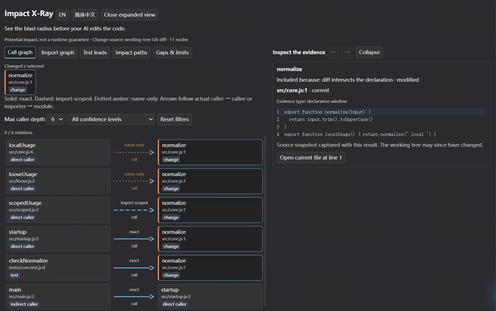
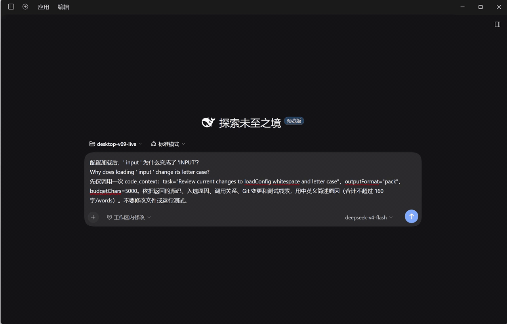
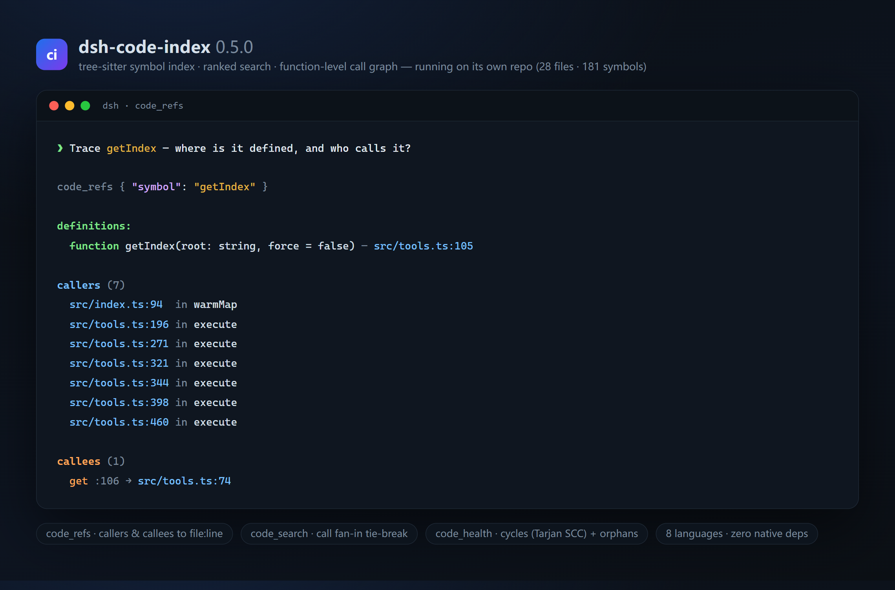

# dsh-code-index

[](https://www.npmjs.com/package/dsh-code-index)
[](https://github.com/lemonxiny55/dsh-code-index/actions)

[English](README.md) | 中文 · [v0.14.0 Release](https://github.com/lemonxiny55/dsh-code-index/releases/tag/v0.14.0) · [npm v0.14.0](https://www.npmjs.com/package/dsh-code-index/v/0.14.0) · [CHANGELOG](CHANGELOG.md)

> **在 AI 动手改代码之前，先看清“爆炸半径”。**
>
> 面向 [DeepSeek Harness（DSH）](https://github.com/deepseek-ai/deepseek-harness) 的本地代码智能插件——在让 AI Agent 修改代码前，先看清变更符号源码、穿透别名与 barrel 后的调用链、最小验证命令线索、变更环依赖预警与跨包影响。

- **真实仓库精度与验证线索（`v0.14.0` 新增）：** 支持 `tsconfig.json`/`jsconfig.json`/`package.json#exports`/鸿蒙 `oh-package.json5` 路径别名、有界 barrel re-export 穿透（`maxReexportDepth = 3`）、`Review Brief` 静态 `commandLead`（绝不自动执行）、变更范围 `cycle-warning` 与 Monorepo `Cross-package impact`。
- **Review Brief：** 通过 `code_change_context`（`outputFormat: "review"`）输出结构化 `{ text, brief }` 评审摘要，直出源码、关系、`Test Leads` 与显式 `Evidence Gaps`。
- **Impact X-Ray：** Desktop 交互式潜在影响图（`outputFormat: "xray"`），点击关系即可核对真实源码位置、来源证据与跨包影响。
- **调用链与排名检索：** 调用图追踪（`code_refs`）、排名符号检索（`code_search`）与 PageRank 仓库地图（`code_map`）。
- **5000 字符硬预算 Context Pack：** 一次 `code_context` 调用返回有界、可直接用于修改的源码上下文（默认 5000 / 300–20000 JS 字符），带入选理由、关系来源与明确缺口。
- **100% 本地运行、零外部 API Key：** 纯 Tree-sitter WASM 解析 + 磁盘 mtime 增量缓存（schema 5）+ 多 Worktree 独立隔离。
- **支持含鸿蒙 ArkTS（`.ets`）在内的 9 种语言：** ArkTS、TypeScript、JavaScript、Python、Go、Rust、Java、C++ 与 C，无需原生编译。

---

## 快速开始

需要 **Node ≥ 22**（已在 Node 22/24 验证），并确保 DSH 宿主中的第一方包版本配套。用 Desktop 自带的 `dsh` CLI 一行安装：

```sh
dsh plugin --profile desktop add dsh-code-index@0.14.0
```

安装后重启 DSH Desktop，即可直接向 Agent 发送试用指令：

> **“对当前工作区调用 `code_change_context`（`outputFormat: "review"`，`budgetChars: 5000`），总结变更符号源码、静态调用者、候选测试与证据缺口。”**

或者试用 `code_context` 定位 Bug：

> **“用 `code_context` 定位一个配置加载 Bug，给出相关源码、调用者和可能受影响的测试。”**

<details>
<summary>更多安装方式：Web profile、本地源码构建、peer 依赖说明与 WSL 符号链接修复</summary>

### Web profile 安装

```sh
npx @deepseek-ai/dsh@0.2.1-rc.2 plugin --profile web add dsh-code-index@0.14.0
npx @deepseek-ai/dsh@0.2.1-rc.2 web
```

也可在匹配的 `0.2.0-rc.2` profile 中从 npm 或本地检出目录安装：

```sh
# 从 npm（预编译）
npx @deepseek-ai/dsh@0.2.0-rc.2 plugin --profile web add dsh-code-index@0.14.0

# 或从包含本仓库检出副本的目录
npx @deepseek-ai/dsh@0.2.0-rc.2 plugin --profile web add ./dsh-code-index
```

重启 Web UI（`npx @deepseek-ai/dsh@0.2.0-rc.2 web`）——启动日志会确认每个工具：

```text
[dsh-code-index] plugin loaded
[dsh-code-index] registered tool: code_index
...
```

不启动即可核对组合配置：`dsh --profile web --dump-config`。

### 本地源码构建

在仓库根目录执行：

```sh
pnpm install
pnpm build
# 然后安装到 web profile
dsh plugin --profile web add .
```

### Peer 依赖与兼容历史

需要 `dsh`（任意安装方式——npx、npm 或源码）与 Node ≥ 22。

- **声明的 peer 要求（v0.13.0 延续 v0.12.0）：** `@deepseek-ai/dsh-tools: >=0.2.0-rc.2 || >=0.2.1-rc.2 <0.2.2 || >=0.2.2-rc.1 <0.2.3` 及可选的 `@deepseek-ai/cordis: ^4.0.1`。
- 新增的显式 RC 范围修复了已声明 DSH 0.2.1 / 0.2.2 RC 版本组的正常 npm peer 解析，无需 `--force` 或 `--legacy-peer-deps`；但不代表所有未来 SDK 或宿主均经过验证。
- DSH 宿主检查包含预发布版本，npm 使用默认预发布匹配规则；允许加载不等于已经验证。请保持 DSH/`dsh-tools` 及其他第一方包的版本配套；插件接口仍属于预览 API。
- **兼容历史：** v0.10.0 精确锁定 `0.2.0-rc.2`；v0.10.1 列举当时支持的版本组；v0.11.2 放宽宿主范围；v0.12.0 为 npm peer 解析补充显式 RC 范围。开发依赖保留 `0.2.0-rc.2` 以检查旧版 API，不代表每次运行时验证均使用该 SDK。

### WSL → Windows 检出符号链接修复

从 WSL 对 `/mnt/c` 下的检出运行 `pnpm install`，会留下 Windows 侧 Node 无法穿透的 Linux 风格符号链接（`Cannot find package 'web-tree-sitter'`、`EACCES`）。无需重装，在 Windows 侧运行一次修复：

```sh
node.exe scripts\fix-wsl-links.mjs            # 本仓库的 node_modules
node.exe scripts\fix-wsl-links.mjs C:\Users\you\.dsh\profiles\web   # dsh profile 里的插件安装
```

它会把每个失效链接以 junction 形式重新指向 `.pnpm` store 里的真实位置；可重复执行（幂等，干净时报 `fixed: 0`）。

</details>

---

## v0.14.0 新功能：真实仓库精度与验证线索

在 AI 修改代码前，调用 `code_change_context` 并传入 `outputFormat: "review"`，返回预算受控的结构化 `{ text, brief }` 评审摘要（默认 `text` 与 `xray` 格式仍可使用）：

```json
{"outputFormat":"review","budgetChars":5000}
```

| v0.14.0 核心能力 | 你将看到 |
| --- | --- |
| **路径别名与 Barrel Re-export 穿透** | 解析 JSONC `tsconfig.json`/`jsconfig.json`（`extends`、`baseUrl`、`paths`）、本地 `package.json#exports`、鸿蒙 `oh-package.json5` 以及 `export { ... } from` / `export * from` 链（`maxReexportDepth = 3`，防环），附确定性 `via` 说明；多匹配通配符严格退化为 `import-scoped` 并记录 `ambiguous-alias`。 |
| **验证命令线索（`commandLead`）** | 在 `Review Brief` 中基于 `package.json`（Vitest/Jest）、`pyproject.toml`、`go.mod`/`go.work` 与 `Cargo.toml` 确定性推导最小范围测试命令——绝不自动执行测试（`verification: "not-run"`），无法识别时留空并记 `verification-command-unavailable`。 |
| **变更环依赖预警（`cycle-warning`）** | 在 `review` 模式下复用 Tarjan SCC，仅对包含本次变更文件的 import 环输出有界告警。 |
| **Monorepo 跨包影响（`Cross-package impact`）** | 解析 `pnpm-workspace.yaml`、`package.json#workspaces`、`Cargo.toml`、`go.work` 与鸿蒙 `build-profile.json5` 边界，在 `Review Brief` 与 `Impact X-Ray` 中汇总跨包引用；严守 300–20000 字符预算，紧预算下优先裁 `commandLead`。 |

- **发布说明与证据：** [v0.14.0 发布说明](RELEASE_NOTES_v0.14.0.zh-CN.md) · [v0.14.0 验收证据](RELEASE_EVIDENCE_v0.14.0.md) · [v0.14.0 工程方案](V0.14.0_PLAN.md) · [Review Brief 教程（v0.13.0）](docs/development/v0.13.0/DEMO.zh-CN.md)

<details>
<summary>Review Brief 预算规则、截图来源与能力边界</summary>

- **预算口径：** 完整 `{ text, brief }` JSON 预算默认 5000，范围为 **300–20000 个 JavaScript 字符**，不是模型 token 上限，也不包含宿主开销。
- **证据边界：** 候选测试未运行，静态关系不证明运行时影响，证据缺失不等于不存在；仓库元数据是非原子观察，编辑后应重新查询。
- **符号选择：** `symbols` 必须使用 `code_symbols` 返回的精确 ID；省略时使用工作区 diff。
- **截图来源：** [六张 v0.13.0 Desktop 截图](docs/assets/v0.13.0/README.md)展示实际 Host API 工具结果在 Desktop 中的回放，均标记为 **Host API replay / no model call**，不是模型 Agent 的 UI 交互截图。Agent 与 DSH rc.3 的独立验证范围见[稳定版验收记录](docs/development/v0.13.0/STABLE_ACCEPTANCE.zh-CN.md)。

</details>

---

## 实际效果演示

### 1. Impact X-Ray — 30 秒真实 Desktop 演示

`normalize()` 被修改 → 查看调用者与测试线索 → 点击关系查看真实源码位置。



[观看 MP4](assets/impact-xray-mvp.mp4) · [全尺寸 GIF](assets/impact-xray-mvp.gif) · [演示说明与复现](assets/impact-xray-mvp-demo.md) · [MVP 报告](IMPACT_XRAY_MVP.md) · [从 npm 安装 v0.14.0](https://www.npmjs.com/package/dsh-code-index/v/0.14.0) · [项目主页](https://github.com/lemonxiny55/dsh-code-index)

让 Agent 调用 `code_change_context` 并传入 `{"repoRoot":"D:/absolute/path/to/repo","outputFormat":"xray"}`，展开工具结果，选择“放大查看”，再点击任意箭头：

| 关系 | 视觉 | 含义 |
| --- | --- | --- |
| `exact` | 实线 | 既有索引模型中的结构解析，不保证运行时必然受影响 |
| `import-scoped` | 虚线 | 导入范围证据，保留原始原因 |
| `name-only` | 黄色点线 | 名称候选，需要人工核实 |

<details>
<summary>Impact X-Ray 录制来源、展示上限与本地复现方式</summary>

- **录制来源：** 录屏来自真实 DSH Desktop 0.2.1-rc.2 中的 `0.11.0-dev.0` MVP 操作，展示的是既有分析与源码证据；它不代表模型驱动 Agent 的耗时或成功率。详见[录制来源](assets/impact-xray-mvp-demo.md)。
- **交互视图边界：** Impact X-Ray 是既有 `code_change_context` 分析及源码读取能力的交互展示，并未新增影响分析引擎。从 Git diff 或明确选定的文件/符号出发，查看调用者、导入依赖、影响路径和测试候选；点击关系可查看其来源及可用的文件行号和源码快照。请把候选视为线索：`name-only` 匹配可能不确定；测试线索不证明覆盖率或测试失败；关系属于静态证据，不保证运行时必然受影响。
- **界面与箭头语义：** 界面跟随宿主语言，也可切换 English / 简体中文。调用图、导入图、测试线索、影响路径和缺口分别展示。深度/来源筛选和本地展开只操作本次有界快照，不会额外请求分析。箭头保留真实 caller → callee 或 importer → module 端点；测试惯例不会被补成函数调用边。整条路径保留最弱关系的来源等级。源码是请求时的快照，编辑后应重新运行。删除声明在可用时显示基线源码，不提供误导性的“打开当前文件”入口。
- **展示上限：** 展示上限为 **32 节点、48 箭头、12 路径、测试/导入各 8 条**；每段源码最多 900 字符、metadata 最多 96,000 UTF-8 bytes。调用关系最多使用 24 个符号节点 / 32 条箭头，给模块线索留出预算。可选 X-Ray 文本最多 24,000 JS 字符；默认 canonical 文本和 `code_context` pack 保持不变。底层索引/引用分析先于展示投影执行，因此 UI 上限不代表大仓库分析的固定内存保证。实际测量和宿主兼容方法见 [MVP 报告](IMPACT_XRAY_MVP.md)。
- **本地复现真实 Demo**（已有目录会拒绝覆盖）：

```sh
npm run build
node scripts/impact-xray-demo.mjs D:/absolute/path/to/new-demo-repo
```

脚本提交六个源码文件的基线，再将 `normalize()` 从 trim 改为大写转换。基线 Node 测试通过；改动后的测试故意失败。`looseUsage` 故意没有 import，保留为不确定的 `name-only` 候选。

</details>

### 2. `code_context` — 42 秒真实 DSH 桌面 Bug 定位演示

**加载 `' input '` 为什么变成了 `'INPUT'`？** 一次真实 `code_context` 调用返回 `src/config.ts:1–3` 的 `loadConfig`、调用方、Git 增改删和相关测试线索，附入选理由与关系来源，共 **2347/5000 字符**——Agent 据此迅速定位到 `.toUpperCase()`。



[MP4 视频](assets/desktop-agent-v090.mp4) · [录制与来源说明](assets/desktop-agent-v090.md) · [实际工具卡片证据](assets/desktop-agent-v090.evidence.json) · [中英终端回放](assets/agent-context-demo.md) · [30 秒本地工具演示](assets/context-pack-demo.html)

<details>
<summary>录制来源、Context Pack 预算机制与较早 code_refs 示例</summary>

- **录制来源：** 这是 **2026-10-08 新录制的真实桌面画面**，使用已安装的 v0.9.0 与一个小演示仓库。只展示 DSH，剪去等待并移除音轨；没有修改文件或运行测试，不代表实际耗时，也不宣称修复或测试成功。
- **更多历史回放：**
  - 先前的[中英终端回放](assets/agent-context-demo.md)继续保留，单独标明来自 2026-10-05 的真实 Agent 记录，补充展示外部编辑刷新及 500 字符下的签名降级。
  - 早期的 [30 秒本地工具演示](assets/context-pack-demo.html) 仍然保留，可用 `pnpm build` 后运行 `node scripts/context-pack-demo.mjs` 复现。它是独立的 Context Pack 演示，不是上方 Impact X-Ray 的 Desktop 实录。
- **`code_context`（Edit-ready Context Packs）机制：**
  - **预算内直接给源码：** 完整声明 → 整行窗口 → 明确的 signature-only 降级。重叠源码行去重，current/base 分开，不切断代码行。
  - **唯一最终 pack：** 默认 canonical return 保持 **string**；显式传 `outputFormat: "pack"` 才返回导出的 `ContextPack` DTO。文本与最终 pack 的 JSON 均受控于同一预算（`budgetChars` 默认 5000，规范化到 300–20000 JavaScript 字符串字符，不是 token 或 UTF-8 字节；`maxFiles` 默认 12，`maxSymbols` 默认 10）。小预算可能只剩签名或缺口；仓库身份本身无法放入预算时返回明确错误。展示任务摘要最多 120 字符，不影响路由。
  - **任务路由与候选排序：** 识别修改、符号、架构、测试、探索和模糊任务。用 camel/snake 分词及文件名、路径、签名 terms 做确定性候选排序，保留 exact symbol；从强 primary seed 找 clean-tree likely tests，图邻域有界。不使用 BM25。
  - **可检查的证据与 Git 分类：** 入选 `reason` 与关系的 `exact` / `import-scoped` / `name-only` provenance 分开，不编造概率或 confidence。`items` 包含 `file/startLine/endLine/side/ref/mode/code`、`reason` 及适用时的 `resolution/provenance`；`budget.usedChars` 对应文本，`budget.packChars` 对应 JSON；用 `renderContextPack` 渲染，不暴露隐藏候选列表。Git 变化使用固定的 baseline commit 判定 added/modified/deleted，保留可靠文件 rename；结构身份不明确或 baseline 缺失时为 `unclassified`，不猜 symbol rename。`code_change_context` 的显式 `files`/`symbols` 仍是选择模式，不构成 Git modified 的证据。
- **较早的 `code_refs` 调用图输出**（既有工具的较早真实示例，不是 v0.9 Context Card）：



</details>

---

## 8 大工具速览

| 工具 | 用途 |
| --- | --- |
| `code_index` | 查看 / (重)建当前工作区的索引 |
| `code_symbols` | 列出符号（函数、类、接口、类型、方法……），带 `file:line`——支持按名称、路径、类型、是否导出过滤 |
| `code_search` | 排名检索：精确 > 前缀 > 子串 > 子序列模糊，导出优先，带相关度分数与 `file:line` |
| `code_map` | 限量排名仓库地图（按符号密度 + import 图 PageRank 取核心文件 + 关键符号与行号） |
| `code_refs` | 沿调用图追踪符号：callers（谁调用了它）与 callees（它调用了谁），解析到 `file:line` |
| `code_change_context` | 从工作区或显式 diff 出发，返回变更符号、调用者、import 依赖、有限影响路径和可能受影响的测试（支持 `text` / `review` / `xray`） |
| `code_context` | Edit-ready ContextPack：有界源码、理由、关系、变化/测试、缺口和硬预算，默认文本返回（可选 `pack`） |
| `code_health` | 可选开启（`codeHealth: true`）：环依赖（import 环）与孤儿模块 |

外加一个可选的**自动注入系统提示词段**（`code-index:repo-map`，序 60）：自动选择当前 DSH 会话工作区的精简排名地图。将 `autoInject: false` 可关闭，只依赖 `code_map` 工具。

*索引*本身不需要 API key（模型当然需要配置好才能调用工具）。常用提问示例：
- “我们现在在哪个仓库？先跑 `code_map`。”
- “找出所有名字含 `parse` 的函数及其位置。”
- “列出 `src/core` 里的导出符号。”
- “工作区改了什么、谁调用了它、哪些测试可能受影响？”
- “修复启动时重复加载配置。”（路由器会自动选择最有用的最小上下文）

---

## 9 种语言支持与多 Worktree 隔离

### 9 种语言纯 Tree-sitter WASM 解析（无需原生编译）

**ArkTS、TypeScript、JavaScript、Python、Go、Rust、Java、C++、C**（`.ets .ts .tsx .mts .cts .js .jsx .mjs .cjs .py .pyi .go .rs .java .cpp .cc .cxx .c++ .hpp .hxx .hh .h .ipp .tpp .inl .c`）。

- **鸿蒙 ArkTS（`.ets`）：** 内置独立、版本锁定的 WASM parser，支持定位 `struct` 组件、方法、字段和装饰器（`@Component`、`@ComponentV2`、`@State`、`@Local`、`@Builder` 等），追踪静态可确定的 ETS/TS 引用，并通过有界 Context Pack 返回真实源码。
- **C / C++：** 符号提取通过 declarator 链解析名字（模板、`ns::name` 限定定义、类内方法），`#include "…"` 接入 repo map 的引用图。
- **可扩展接缝：** `src/extract.ts` + 语法文件预留了后续接入其他语言或嵌入检索的位置。

### 多 Worktree 隔离与外部编辑实时刷新

```text
打开仓库 A → 搜索到 A 的符号
切换到仓库 B → 搜索到 B 的符号，不会混入 A
从 DSH 外部修改文件 → 下一次查询看到变化
切回 A → A 的上下文仍然独立
```

每个 Git worktree 都有独立索引和变更状态（按规范真实路径最多保留 4 个上下文）。索引在首次使用时惰性构建，后续按 mtime 增量刷新，遵守仓库根目录及嵌套 `.gitignore`（保留 v0.9.1 目录白名单修复），并自动监听活动项目的外部增删改，无需手动重建。

---

## 严谨声明、技术细节与历史验收

<details>
<summary>验证边界与历史版本验收记录（v0.14.0 / v0.13.0 / v0.12.0 / v0.11.1 / v0.10.0）</summary>

### v0.14.0 — Real-Repo Precision & Verification Leads

- **发布说明与证据：** [v0.14.0 发布说明](RELEASE_NOTES_v0.14.0.zh-CN.md) · [v0.14.0 验收证据](RELEASE_EVIDENCE_v0.14.0.md) · [CHANGELOG](CHANGELOG.md)
- **验收范围：** 本次已通过本地 `pnpm typecheck`、36 个 Vitest 测试套件（`pnpm test`）、ESM/DTS/Client 生产构建（`pnpm build`）及干净 tarball 安装与 `ToolRuntime` 冒烟验收（`pnpm release:smoke`）。本次**未运行**新的 DSH Electron Desktop UI 实测或真实模型 Agent 实测。

### v0.13.0 — Review Brief

- **发布链接：** [GitHub Release v0.13.0](https://github.com/lemonxiny55/dsh-code-index/releases/tag/v0.13.0) · [npm v0.13.0](https://www.npmjs.com/package/dsh-code-index/v/0.13.0) · [发布说明](RELEASE_NOTES_v0.13.0.zh-CN.md)
- **截图说明：** [六张 v0.13.0 Desktop 截图](docs/assets/v0.13.0/README.md)展示实际 Host API 工具结果在 Desktop 中的回放，均标记为 **Host API replay / no model call**，不是模型 Agent 的 UI 交互截图。
- **独立验证范围：** SDK、Desktop、Agent 与 DSH rc.3 的独立验证范围见[稳定版验收记录](docs/development/v0.13.0/STABLE_ACCEPTANCE.zh-CN.md)。

### v0.12.0 — Reliable Context & Evidence（2026-11-09）

- **发布链接：** [GitHub Release v0.12.0](https://github.com/lemonxiny55/dsh-code-index/releases/tag/v0.12.0) · [npm v0.12.0](https://www.npmjs.com/package/dsh-code-index/v/0.12.0)
- **在 v0.13.0 中继续保留的核心能力与边界：**
  - 确定性中文任务路由、路径与显式符号区分、源码优先的候选选择改进 Context Pack，并保留英文任务回归。
  - 可选 **Evidence Summary**（`ContextPack.evidence`）说明已索引文件诊断、静态关系等级、候选测试及实际检测到的缺口。`parsed` 不等于语义完整；零静态调用者不能证明不存在调用者。
  - evidence 可在同一 text/JSON 预算内缩减或省略；字段缺省表示**未提供**，不能解释为没有缺口。默认 5000、300～20000 字符边界不变。
  - 测试关联只是线索，不代表已执行、通过或覆盖已验证；静态关系不保证运行时行为。
  - 修复已声明 DSH 0.2.1 / 0.2.2 RC 版本组的正常 npm peer 解析，无需 `--force` 或 `--legacy-peer-deps`；不代表所有未来 SDK 或宿主均经过验证。
- **历史验证文档：** [候选集成验收记录](docs/development/v0.12.0/INTEGRATION.zh-CN.md)、[M2 证据契约](docs/development/v0.12.0/M2.zh-CN.md)及[最终发布就绪检查](docs/development/v0.12.0/RELEASE_READINESS.zh-CN.md)保留各阶段的方法、失败与限制。其中发布前状态仅描述当时阶段；正式发布及公开安装验证以[已发布 Release 记录](https://github.com/lemonxiny55/dsh-code-index/releases/tag/v0.12.0)为准。
- **验证边界：** 公开安装验证使用 SDK 0.2.2-rc.1 / Cordis 4.1.0（8 工具注册、7 次管线调用通过、卸载后 0 注册残留），属于 SDK/runtime smoke，并非重跑 Desktop UI 验收。此前 Desktop 0.2.2-rc.1 检查覆盖图和文本渲染，边点击额外交互在 Web 实测。两项真实 Agent 有限复验使用临时 8192 token 上限，仅调用指定代码工具并完成回答；不保证任意 shell 权限、任意任务成功或模型/网络可靠性。

### v0.11.1 — Impact X-Ray 历史验证范围

- Desktop 0.2.1-rc.2 完成完整 X-Ray UI 验证；Web/Host rc.3 完成全部八个工具及 X-Ray 验证（未运行模型驱动 Agent）；Desktop 0.2.0-rc.2 通过安装和 ToolRuntime 检查，未验证完整 X-Ray UI。宿主中的第一方包须使用同一已声明版本。见 [v0.11.1 验证与限制](RELEASE_EVIDENCE_v0.11.1.md)。

### v0.10.0 — ArkTS 历史验证与 v0.9.1 Gitignore 修复

- [v0.10.0](https://github.com/lemonxiny55/dsh-code-index/releases/tag/v0.10.0) 引入的 ArkTS 功能在 v0.13.0 继续保留：v0.10.0 安装包曾通过 DSH Desktop 真实 Agent 验证及 Node 22/24 发布检查，这是历史验证，并非本次重新运行 v0.12.0/v0.13.0 ArkTS 验收；部分解析或解析失败会提供有限诊断。
- 见[发布证据](RELEASE_EVIDENCE_v0.10.0.md)、[ArkTS PoC](ARKTS_POC_v0.10.0.md) 和[双语公告](assets/v0.10.0-announcement.md)。v0.9.1 的 Gitignore 目录白名单修复继续保留。

</details>

<details>
<summary>静态分析与运行时边界、ArkTS 能力限制与已知限制</summary>

### 静态分析与运行时边界

- 静态关系（`exact`、`import-scoped`、`name-only`）是索引层面的静态证据，不保证运行时必然受影响；零静态调用者不能证明不存在调用者。
- 测试关联（`Test Leads`）只是候选线索，不代表测试已执行、通过或覆盖率已验证。
- `parsed` 只表示语法提取完成，不承诺完整语义引用。
- 证据缺省或字段省略表示**未提供**，不能解释为“没有缺口”或“证明不存在”。
- 仓库元数据（root、HEAD/base、dirty 状态、索引/元数据时间）是非原子观察，代码修改后应重新运行查询。
- `code_change_context` 默认分析相对于 `HEAD` 的当前 Git 工作区，也支持内联 unified diff、仓库相对 `files` 或稳定的 `symbols` ID；删除和重命名在可用时读取 baseline，工作区模式也会包含未被忽略的未跟踪源码文件。

### ArkTS 功能与限制

- 支持语法、静态代码上下文、本地 `oh-package.json5` 相对路径依赖解析（含 `Index.ets` 默认入口）、`build-profile.json5` 多模块边界以及有界 ETS/TS re-export 穿透（`maxReexportDepth = 3`），不包含完整 HarmonyOS SDK 语义、`oh_modules` 第三方源码解析、状态更新或 UI 重渲染调用图。
- `struct` 组件使用现有 `kind: class`，签名为 `struct Name`。方法、字段、全局函数、class/interface/type/enum 和模块变量保留稳定的限定 ID、所属作用域和源码行号。`@Component`、`@ComponentV2`、`@State`、`@Local`、`@Builder` 等装饰器保留为元数据，装饰器所在行纳入定义源码范围。
- 能解析 `build()` 和嵌套声明式 UI；本地组件、显式 ETS/TS import 接入符号、搜索、地图、引用、变更上下文和 Context Pack。`@Extend` 元数据及 UI 属性链不会被当作业务调用关系。UI 块内大写裸调用不使用全仓库同名或仅导入模块的回退，避免给无绑定的 SDK 组件（`@ohos.*` / `@kit.*`）关联无关项目符号。普通 callback/业务调用沿用已有 provenance；ArkTS 的 `code_refs` 使用按绑定解析的候选关系。
- 唯一可确定目标的相对及本地 `oh-package.json5` 混合 ETS/TS import 可解析；同一无扩展名路径同时存在 ETS 和其他源码时不猜测；歧义通配符退化为 `import-scoped` 并写入 `ambiguous-alias`。默认 import 保留 `import-scoped`，不推断 SDK 类型、状态更新或 UI 重渲染语义。无显式绑定的全局自定义 UI 组件可能没有关系边。语法解析通过不等于 ArkTS 编译通过或鸿蒙运行时行为已验证。
- 每个索引文件记录 `parsed` / `partial` / `failed`、ERROR/MISSING 数量和最多三处位置。不可靠的 ArkTS 声明会被省略，避免错误的范围或所属作用域。`code_index` 提供有限的索引不完整摘要，Context Pack 和变更上下文在原有预算内保留缺口。缓存 schema 5 自动重建旧缓存并随配置 mtime 变化增量失效，仍不持久化源码正文。
- grammar 使用 [harmony-contrib 0.3.0](https://github.com/harmony-contrib/tree-sitter-arkts)，ABI 14，未经修改的 npm WASM 与 MIT 声明随包发布，消费端无需原生 ArkTS addon。见 [WASM 来源](grammars/README.md)。

### 已知限制

- **web-tree-sitter 固定为 `^0.25`（ESM）** —— 0.25 采用 ESM 具名导出（`Language`/`Query`）；与 `tree-sitter-wasms` 静态构建的组合在 Node ≥ 22/24 下验证可用。
- 自动注入地图使用 DSH system prompt assembly 提供的当前会话上下文。没有 Agent 的 prompt assembly 会回退到 DSH 进程工作目录。新访问的项目第一次注入可能暂时为空，待索引完成后后续 assembly 会使用项目地图。
- Watcher 只为工具实际访问的项目启动，并随插件卸载清理。设置 `externalWatch: false` 后，每次工具调用仍会扫描元数据以发现常规 mtime 变化。
- 大型 monorepo 每次工具调用仍需要扫描目录元数据。文件解析是增量的，但扫描耗时取决于仓库规模和磁盘速度。
- 不索引函数局部变量；索引模块声明和类成员，parser/graph 不等同于 type checker。
- current 源码读取会拒绝索引快照后发生变化、真实路径越出 root 或超过 1 MB 的文件；signature-only 和 gaps 标明缺失证据。Likely tests 是线索，不保证覆盖。

</details>

<details>
<summary>配置选项、工作原理与本地开发</summary>

### 配置

选项通过插件行的 `config` 在 profile 补丁中传入（缺省时使用默认值；继续保留 full/compact surface 与 v0.8 配置）：

```yaml
# $DSH_HOME/profiles/<name>/cordis.patch.yml —— 裸行按 id 覆盖。
- id: code-index
  config:
    excludeDirs: [generated, playground]
    mapTopFiles: 30
    mapMaxChars: 4000
    autoInject: true
    toolSurface: full
```

| 键 | 默认 | 含义 |
| --- | --- | --- |
| `excludeDirs` | `[]` | 追加到内置排除列表的目录名，按路径组件精确匹配；不支持 `secrets/**` 这类 glob |
| `mapTopFiles` | `24` | 排名地图中的最大文件数 |
| `mapMaxChars` | `3200` | 渲染地图的硬性字符上限 |
| `mapTtlMs` | `60000` | 自动注入地图的刷新间隔（毫秒，最小 1000） |
| `autoInject` | `true` | 是否注册系统提示词段 |
| `codeHealth` | `false` | 是否注册 `code_health` 工具（环/孤儿模块） |
| `toolSurface` | `full` | 实验性的 `compact` 模式只暴露 `code_index`、`code_context` 和已启用的 `code_health`；`full` 保持全部工具 |
| `externalWatch` | `true` | 监听当前活动项目的外部源码变更 |
| `watchDebounceMs` | `120` | 合并文件事件后再刷新受影响文件（最小 20 毫秒） |

### 工作原理

- **索引构建与配置解析**（`src/buildIndex.ts`、`src/alias.ts`、`src/workspace.ts`）：递归扫描（应用排除规则），逐文件 tree-sitter 提取（`src/extract.ts`），轻量归一化别名与工作区配置（`tsconfig`/`jsconfig`/`package.json`/`oh-package.json5`/`pnpm-workspace.yaml`/`Cargo.toml`/`go.work`/`build-profile.json5`），JSON 缓存（schema 5）置于 `<repo>/.dsh-code-index/`，按源码及配置 mtime 增量刷新（不持久化源码正文）。
- **搜索**（`src/search.ts`）：纯打分——精确 `1` / 前缀 `0.8` / 子串 `0.5`，导出加权，名称序平局裁决。
- **仓库地图**（`src/repomap.ts`）：import 图上的个性化 PageRank（传送向量 = 各文件密度份额，被其他枢纽文件引用的枢纽会比平铺入度统计排得更靠前），以密度感知的文件打分为底（class/interface/function 加权，测试路径衰减），取 Top-N 文件，每文件符号上限，硬截断。
- **调用图**（`src/refgraph.ts`）：逐文件提取调用点（按语言，并记录其所属函数），通过局部作用域、配置别名与有界 barrel re-export 链（`maxReexportDepth = 3`，防环）解析成 callers 与 callees——`code_refs` 直接暴露，`code_search` 也把调用热度作为排名平局裁决。
- **变更上下文与 Review Brief**（`src/change-context.ts`、`src/review-brief.ts`、`src/test-leads.ts`）：把 Git hunk 映射到稳定符号，在有限深度内追踪带来源标签的调用者、import 依赖（含反向 barrel 链）、入口路径、跨包汇总、变更环依赖预警与确定性静态 `commandLead`（绝不执行测试）。
- **ContextPack**（`src/context.ts`、`src/context-pack.ts`、`src/source-excerpts.ts`）：候选排序、临时读取源码证据、按文本/JSON 预算选择唯一 DTO，再渲染入选项。
- **健康检查**（`src/health.ts`）：对 import 图跑 Tarjan SCC 得到环依赖；孤儿模块检测列出既不被 import、也不 import 任何文件的含符号文件（排除入口与测试）。
- **工作区解析**：每个工具解析会话 cwd（`agent.session.header.cwd`）并向上查找最近的 `.git`（有界——没有仓库标记的目录绝不会被索引）。
- **项目上下文**（`src/repo-context.ts`）：用真实规范路径区分各 worktree，最多保留四个上下文。每次工具调用扫描文件元数据并只重解析变化文件；watcher 会在有限 debounce 后刷新脏文件。
- **忽略规则**：索引遵守仓库根目录及嵌套 `.gitignore`；`excludeDirs` 仍是精确目录名列表，不支持 glob。

### 开发

```sh
pnpm install
pnpm test        # vitest —— 提取器、扫描、缓存、搜索、仓库地图、调用图、健康检查
pnpm typecheck
pnpm build       # tsup → dist/index.js（ESM，外部依赖）
pnpm build && pnpm release:smoke # 打包、干净安装 tarball、启动插件并调用核心工具
```

`bench/` 下的 benchmark 对比 stock DSH、已发布的 0.5 基线、0.6 变更感知处理组和 0.7 任务感知处理组，记录任务完成、输入 token、工具调用、轮次和墙钟时间；provider 未提供的 usage 会保留为 null，不会伪造性能数据。当前仓库提供基础设施和示例任务，不宣称已测得性能提升。

</details>

---

## 反馈与许可证

用过 `dsh-code-index`？欢迎告诉我哪些地方有帮助、哪里出错，或缺少了什么上下文。可以回复 [DSH 官方插件介绍讨论](https://github.com/deepseek-ai/deepseek-harness/discussions/5623)；如果仓库允许创建 Issue，也可以使用[反馈 Issue 表单](https://github.com/lemonxiny55/dsh-code-index/issues/new?template=feedback.yml)。

为了方便复现，请尽量说明仓库的大致规模和语言、执行的任务、预期上下文与 Agent 实际收到的内容，以及是否涉及项目切换、worktree 或外部文件修改。请勿粘贴私有源码、凭据或 API key。

**许可证：** [MIT](LICENSE)。与 DeepSeek 无关；基于公开的 `dsh` 插件接口构建。
