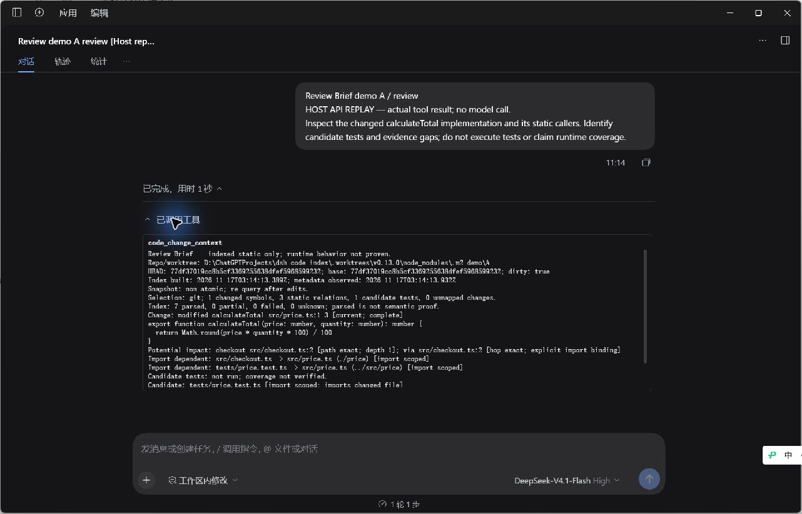
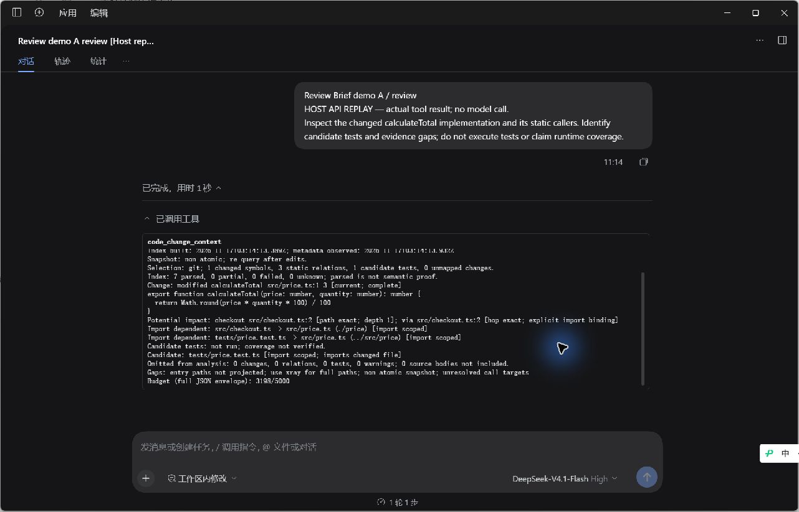
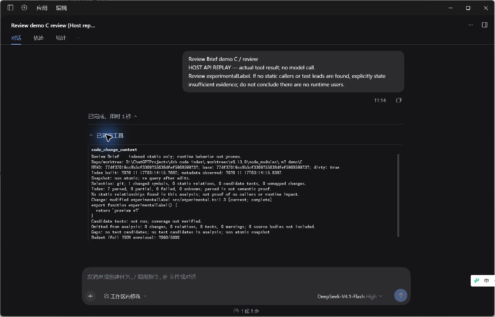

# Review Brief: from one edit to reviewable evidence

Candidate: **dsh-code-index 0.13.0-dev.0**, tested with **DSH Desktop 0.2.2-rc.3**. This describes a development candidate, not an npm release announcement.

## Reproduce locally

Use Node ≥22 and Git with a built candidate checkout, or an installed candidate tarball. The generator uses synthetic source only, requires no API key, runs no tests, and refuses to overwrite an existing directory.

```powershell
node scripts/create-review-demo.mjs ./review-brief-demo
# Alternatively, from an installed candidate:
node node_modules/dsh-code-index/scripts/create-review-demo.mjs ./review-brief-demo
```

The manifest records a baseline repository, three linked Worktrees (A/B/C), and another tiny repository with a distinct marker. The commit SHA varies with creation time. No global Git configuration is changed.

## A two-minute walkthrough

1. Inspect `git -C ./review-brief-demo/A diff`. The prepared edit changes `calculateTotal` from multiplication to rounding to two decimals.
2. In DSH with the candidate loaded, select A and call `code_change_context` with `outputFormat: "review"`, `budgetChars: 5000`, and `repoRoot` set to A's absolute path from the manifest.
3. Expand the completed step and its tool output. Read the current `src/price.ts:1-3` body, the exact static caller `checkout`, and the import-scoped dependents.
4. Inspect the test lead. `tests/price.test.ts` imports the changed file; it is **not-run**, with coverage unverified. Its integer example does not establish coverage of the new rounding behavior.
5. Scroll inside the card to inspect evidence gaps and budget. Check root, HEAD/base, dirty status, index build time and metadata observation time. These are non-atomic observations; re-query after editing.
6. Compare `outputFormat: "text"` and `"xray"`. X-Ray keeps the same model-facing text as text mode; its interactive evidence lives in Desktop presentation metadata.





These are genuine Desktop captures of actual Host tool outputs replayed through the public Session API. Both the title and message say **Host API replay / no model call**. They are not screenshots of a successful model conversation. Independent real Agent A/B/C evidence is recorded in the [M2 acceptance report](M2_ACCEPTANCE.zh-CN.md). No deleted GIF/MP4 was restored.

## Two more cases

| Worktree | Prepared change | Expected evidence | Unsupported conclusion |
|---|---|---|---|
| B | Add `minimumTotal` to public `PricePolicy` | Current interface source, import-scoped `quote.ts` dependency, name-only test path lead | “No call edges means no interface consumers”; “migration is safe” |
| C | Change `experimentalLabel` to return `preview-v2` | Current function, zero static relations/tests, explicit evidence limitation | “No runtime users”; “no tests needed” |

Repeat the query with each Worktree root. Each output must retain its own path and changed symbol. An explicit file query for `other/marker.ts` should show `OTHER_REPO_ONLY`; switching back to A should return calculateTotal.



Suggested Agent prompt:

> Review this Worktree read-only. Call code_change_context once with text and once with review, budgetChars=5000, using the default Git diff selection. Compare current source, static callers/import dependents, candidate test grades and gaps. Identify missing source. Do not execute tests or equate static relations with runtime effects or verified coverage.

`symbols` accepts actual **SymbolInfo.id values returned by code_symbols**, not function names or guessed IDs. Prefer default Git selection. `files` explicitly treats whole files as changed and does not prove those files were changed in Git.

Review embeds selected changed-symbol bodies, not caller/test bodies or a before/after diff. `complete` describes the displayed source span; `omitted.sourceBodies` counts changed symbols only. Use Context Pack or source tools for additional source, and arrange test execution separately. The current UI reuses the existing scrollable text card. Dedicated Review UI, runtime coverage and automatic AgentTeam handoff remain outside this candidate.
