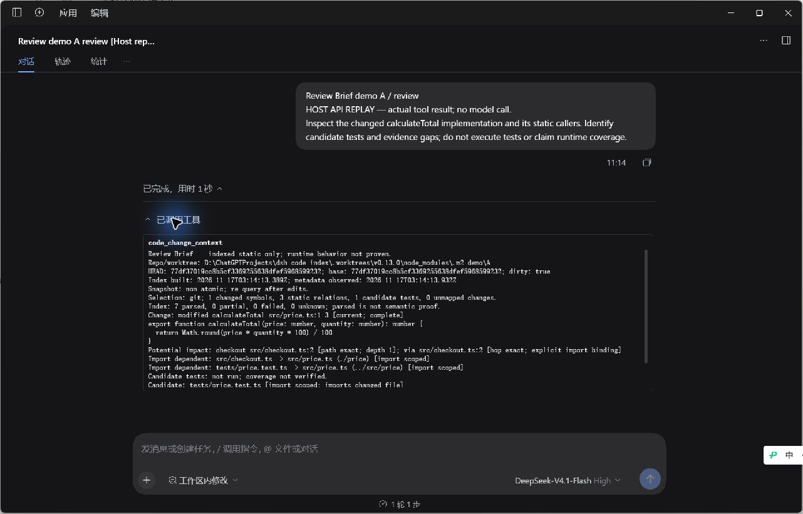
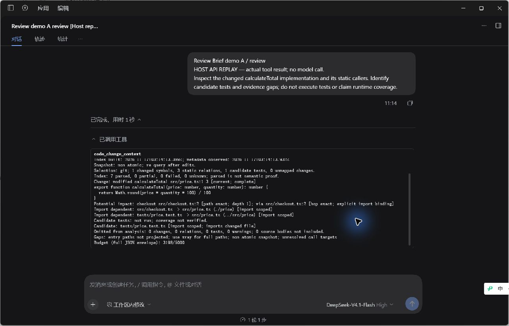
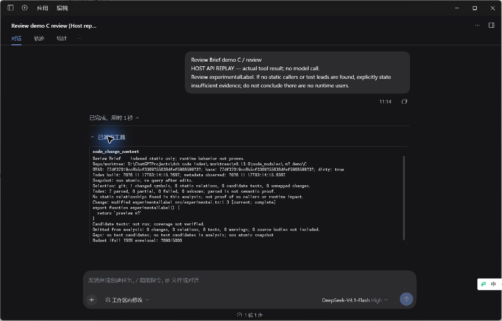

# Review Brief：从一个修改到可审阅的证据

适用候选：dsh-code-index **0.13.0-dev.0**，DSH Desktop **0.2.2-rc.3**。这是开发候选教程，不表示 npm 上已经发布 v0.13.0。

## 创建可复现示例

需要 Node ≥22、Git，以及已构建的候选代码。所有源码均为合成内容，无 API 密钥和私有仓库。生成器不安装依赖、不执行测试、不修改 Git 全局配置，目标目录必须不存在。

在候选代码目录执行：

```powershell
node scripts/create-review-demo.mjs ./review-brief-demo
```

从已经安装的候选 tarball 也可执行：

```powershell
node node_modules/dsh-code-index/scripts/create-review-demo.mjs ./review-brief-demo
```

输出 `manifest.json`、一个基线仓库、A/B/C 三个 linked Worktree 和独立的 `other` 小仓库。生成的 Git commit SHA 随创建时间改变，以本次 manifest 为准。生成器拒绝覆盖已有目录。

## 两分钟演示步骤

1. 打开 `A/src/price.ts`，对比 `git -C ./review-brief-demo/A diff`：`calculateTotal` 从乘法改为保留两位小数。A 已预置该修改，无需手工复刻。
2. 在加载候选插件的 DSH 中选择 A 工作区，让 Agent 调用以下工具。`repoRoot` 换成 manifest 内的绝对路径；不能把示例路径直接照抄。

```json
{
  "name": "code_change_context",
  "arguments": {
    "repoRoot": "<manifest.tasks[A].root 的绝对路径>",
    "outputFormat": "review",
    "budgetChars": 5000
  }
}
```

3. 展开“已完成”→“已调用工具”。读变更函数的 `src/price.ts:1-3` 当前源码，再读 `checkout` 的 exact 静态调用与 import-scoped 模块依赖。
4. 查看 `tests/price.test.ts`：它导入变更文件，因此是候选，状态始终为 **not-run / coverage not verified**。打开测试源码会看到整数输入；不能声称它已经验证新的舍入行为。
5. 在卡片内部向下滚动，查看缺口和预算。核对 root、HEAD/base、dirty、Index built 和 metadata observed；这两种时间不是原子快照保证。修改文件后重新查询。
6. 改用 `outputFormat: "text"` 对照旧文本；再用 `"xray"` 查看静态关系和源码证据。X-Ray 的模型可见文本与 text 相同，交互信息在 Desktop metadata 卡片中；不能据文本相同断言卡片没有信息。





截图来自真实 Desktop，标题及用户消息均明确写了 **Host API replay / no model call**。它们展示实际工具结果经公开 Session API 回放后的 UI；不冒充模型生成结果。另有真实 Agent A/B/C 日志，见 [M2 验收记录](M2_ACCEPTANCE.zh-CN.md)。未恢复任何旧 GIF/MP4。

## 再演示两个容易误判的任务

| 工作区 | 预置修改 | 应看到的证据 | 不应下的结论 |
|---|---|---|---|
| B | `PricePolicy` 新增 `minimumTotal` | 当前 interface 全文、`quote.ts` 的 import-scoped 依赖、`policy.test.ts` 的 name-only 路径线索 | “没有 call 边，所以没有接口消费者”；“迁移安全” |
| C | `experimentalLabel` 返回值改为 `preview-v2` | 当前函数、0 静态关系、0 候选测试及证据不足提示 | “没有运行时用户”；“无需测试” |

分别切换 root 后重复 review。A/B/C 共用 Git 基线，但必须各自显示自己的 Worktree 路径和变更。查询 `other/marker.ts` 时只能出现 `OTHER_REPO_ONLY`，再切回 A 应恢复 calculateTotal。



## 可直接使用的 Agent 提示词

> 只读审阅当前 Worktree。分别调用 code_change_context 的 text 和 review（budgetChars=5000），默认使用 Git diff 选择。根据实际输出解释变更函数、静态调用或导入依赖、候选测试证据等级与缺口；标明缺失源码。不要执行测试，不要把静态关系当作运行时影响，不要声称覆盖已验证。

这里的 `symbols` 参数只接受 **code_symbols 返回的 SymbolInfo.id**，不是函数短名。需要按文件选择时使用 `files`；这表示“把整文件视为变更”，不等于 Git 真的修改了该文件。正常演示优先省略 diff/files/symbols，使用 Git 工作树差异。

## 当前边界

Review 内联的是选中变更符号的**当前源码**（删除场景可取 base）；不自动内联调用者/测试全文，也不提供 before/after diff。`complete` 只指所示符号源码范围完整。`omitted.sourceBodies` 只计变更符号，不能用于推断调用者和测试正文已齐备。需要更多正文时使用原始 Context Pack 或源码读取工具；需要运行验证时另行安排测试。

界面复用既有文本卡片，长内容需内部滚动；本阶段没有新增专用 Review UI、自动 AgentTeam 交接或运行时覆盖分析。
